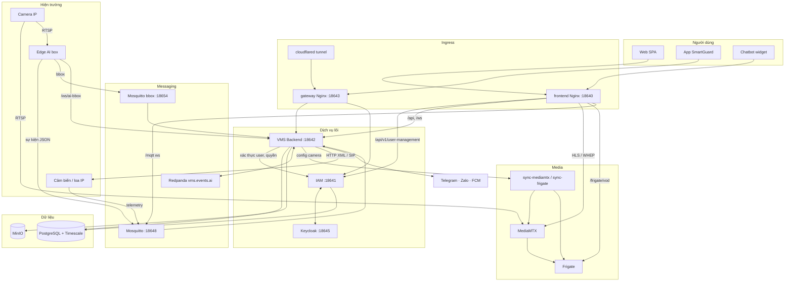

# Kiến trúc hệ thống AIOC

> **AIOC · Smart VMS · System design**
>
> Nền tảng giám sát thông minh đa tổ chức cho khu công nghiệp: camera AI, cảm biến IoT, cảnh báo theo SOP, video trực tiếp và xem lại. Sơ đồ dựng từ compose đang chạy của site prod, đối chiếu với mã nguồn trong workspace.

| | |
|---|---|
| **Phiên bản** | v1.5.1 |
| **Site tham chiếu** | `aioc` (prod, máy .250) |
| **Nguồn** | `aioc-deploy/sites/aioc/compose.yml` |
| **Cập nhật** | 14/11/2026 |

## Mục lục

1. [Các tầng của hệ thống](#1-các-tầng-của-hệ-thống)
2. [Sơ đồ kết nối](#2-sơ-đồ-kết-nối)
3. [Ba luồng chính](#3-ba-luồng-chính)
4. [Bảng định tuyến Nginx](#4-bảng-định-tuyến-nginx)
5. [Mã nguồn, môi trường và phát hành](#5-mã-nguồn-môi-trường-và-phát-hành)
6. [Điểm cần lưu ý](#6-điểm-cần-lưu-ý)

---

## 1. Các tầng của hệ thống

Đọc từ trên xuống: người dùng đi vào qua hai lớp Nginx, tới hai dịch vụ FastAPI lõi. Dữ liệu hiện trường đi từ dưới lên qua MQTT, WebSocket và RTSP.

### 1.1. Người dùng (Client)

| Thành phần | Mô tả | Container / Cổng |
|---|---|---|
| **Web Portal SPA** | React 18, Vite 7, Tailwind 3, i18n vi/en, MapLibre/Leaflet, Three.js | `aioc-frontend` |
| **App di động SmartGuard** | iOS/Android, nhận push qua FCM | REST + WSS |
| **Chatbot widget** | Trang tĩnh + `embed.js` nhúng vào portal | `aioc-chatbot-fe` `:18650` |
| **Micro PTT trình duyệt** | PCM 16-bit 8 kHz mono, đàm thoại loa IP | WSS `/api/v1/speakers/{id}/ptt` |

### 1.2. Ingress (Nginx reverse proxy)

| Thành phần | Mô tả | Cổng |
|---|---|---|
| **frontend (Nginx)** | Phục vụ bundle SPA và proxy toàn bộ route: API, WS, HLS/WebRTC, Frigate, MQTT-WS, STT, tile bản đồ | `:18640` → container `:80` |
| **gateway (Nginx)** | API gateway: `/api/v1/user-management` → IAM; `/api`, `/ws`, `/node` → Backend; còn lại → SPA | `:18643` (host network) |
| **zalo-tunnel** | Cloudflare quick tunnel công khai gateway cho webhook Zalo | `cloudflared` → `:18643` |

### 1.3. Dịch vụ lõi (Python 3.12 · FastAPI)

| Thành phần | Mô tả | Container / Cổng |
|---|---|---|
| **VMS Backend** | 54 router, 92 service: camera, sự kiện AI, IoT, SOP engine, báo cáo, license, loa IP, thông báo. WebSocket `/ws` và `/ws/ai-bbox` | `aioc-backend` `:18642` |
| **IAM Service** | Đăng nhập, Set-Union RBAC, cây không gian L1–L4/L6, single-session, quản lý tổ chức | `aioc-iam` `:18641` |
| **Keycloak 23** | OIDC provider, phát JWT RS256, realm `smart-vms` | `:18645` |
| **overlay-relay / polygon-sync** | Đồng bộ một chiều prod → staging: topic overlay MQTT và polygon camera | image `aioc-backend` |
| **iot-simulator** | Giả lập thiết bị IoT để demo và kiểm thử | `aioc-tools` `:18651` |

### 1.4. Messaging (Sự kiện & realtime)

| Thành phần | Mô tả | Cổng / Topic |
|---|---|---|
| **Mosquitto (`mqtt`)** | Sự kiện AI, telemetry IoT, đẩy cấu hình xuống AI box | mqtt `:18648` · ws `:19048` |
| **Mosquitto (`mqtt-bbox`)** | Broker riêng cho luồng bbox tần suất cao, tách khỏi luồng sự kiện | mqtt `:18654` |
| **Redpanda v24.2** | `AdaptiveKafkaEventBus`, chế độ `direct` \| `auto` \| `kafka`, partition theo camera | topic `vms.events.ai`, `vms.events.dlq` · `:18652` |

### 1.5. Media (`aioc-media`)

| Thành phần | Mô tả | Cổng |
|---|---|---|
| **MediaMTX 1.17** | Nhận RTSP camera, phát WebRTC WHEP (<500 ms) và HLS | HLS `:8889` · WHEP `:18889` · API `:19997` |
| **Frigate 0.17** | NVR: ghi hình 24/7, clip sự kiện, VOD playback | `:5000` |
| **sync-mediamtx / sync-frigate** | Agent nhận cấu hình camera từ Backend, sinh config cho MediaMTX/Frigate | `:18092` · `:21291` |
| **storage_service** | Giám sát dung lượng ổ ghi hình | `aioc-media/storage_service` |

### 1.6. Dữ liệu (Lưu trữ bền)

| Thành phần | Mô tả | Cổng |
|---|---|---|
| **PostgreSQL 16 + TimescaleDB** | Backend dùng 15 asyncpg pool theo miền (core, face, ITS, PPE, fire, datamart…). IAM dùng DB `user` | `:18644` · migrations ở `aioc-database` |
| **MinIO** | Ảnh cảnh báo, ảnh khuôn mặt, bản vẽ mặt bằng, audio | S3 `:18646` · console `:18647` |
| **minio-api** | Lớp API trung gian cho upload/tải object | `:18649` |

### 1.7. Hiện trường & bên ngoài (Edge · 3rd-party)

| Thành phần | Mô tả | Giao thức |
|---|---|---|
| **Camera IP / PTZ / nhiệt** | RTSP main/sub tới MediaMTX và AI box | RTSP |
| **Edge AI box** | Jetson / GPU server: face, biển số, PPE, cháy, vùng cấm… | MQTT · WS bbox |
| **Cảm biến, tủ báo cháy, barrier, loa IP** | Telemetry qua MQTT; loa Fanvil qua HTTP XML / SIP sendonly | MQTT · SIP |
| **Kênh thông báo** | Telegram, Zalo, Firebase Cloud Messaging | HTTPS outbound |
| **Dịch vụ phụ trợ** | Chatbot API (`192.168.1.199:8020`), STT `:8628`, OSM tile `:8092` | LAN |

---

## 2. Sơ đồ kết nối

Mũi tên chỉ chiều gọi chính. Mọi request từ trình duyệt đi qua Nginx; Backend là điểm hội tụ của dữ liệu hiện trường.

---

## 3. Ba luồng chính

### 3.1. Đăng nhập và phiên

1. SPA gọi `POST /api/v1/user-management/auth/login`, Nginx chuyển tới IAM.
2. IAM xác thực với Keycloak (OIDC), kiểm tra user và tổ chức còn hoạt động.
3. Nếu bật single-session, IAM thu hồi phiên cũ và gọi Backend `/api/v1/auth/session-kickout` để đóng WebSocket cũ.
4. Trả JWT RS256. SPA tự refresh trước khi hết hạn; Backend kiểm tra token và hỏi IAM về quyền theo cây không gian.

### 3.2. Sự kiện AI tới cảnh báo

1. AI box phát hiện vi phạm, publish JSON kèm đường dẫn snapshot lên Mosquitto.
2. Backend consume. Ở chế độ `auto`, khi tải vượt ngưỡng EPS hoặc hàng đợi đầy, sự kiện được đẩy qua Redpanda; lỗi xử lý đi vào DLQ.
3. Worker theo miền (plate, fire, zone…) ghi vào pool DB tương ứng, ảnh lưu MinIO.
4. Rule và SOP playbook quyết định người nhận; đẩy qua `/ws`, FCM, Telegram, Zalo.

### 3.3. Video trực tiếp và xem lại

1. Backend gửi cấu hình camera cho `sync-mediamtx` và `sync-frigate`; hai agent sinh config và nạp lại dịch vụ.
2. MediaMTX kéo RTSP từ camera. SPA mở WebRTC WHEP qua `/mediamtx/webrtc/`, fallback HLS.
3. Frigate ghi hình 24/7. Xem lại qua `/frigate/vod/`; Backend dựng playlist VOD theo tổ chức.
4. Bbox realtime vẽ đè lên video nhờ `/ws/ai-bbox`; Backend chỉ chuyển bbox của camera đang có người xem.

---

## 4. Bảng định tuyến Nginx

Rút gọn từ `nginx/frontend.conf.template` và `nginx/gateway.conf` của site `aioc`.

| Đường dẫn | Đích | Ghi chú |
|---|---|---|
| `/api/v1/user-management/` | IAM `:18641` | Rewrite thành `/api/v1/` |
| `/api/v1/speakers/{id}/ptt` | Backend `:18642` | WebSocket upgrade cho PTT |
| `/api/`, `/ws`, `/node/` | Backend `:18642` | REST và WebSocket chính |
| `/mediamtx/hls/`, `/mediamtx/webrtc/`, `/mediamtx/api/` | MediaMTX `:8889` / `:18889` / `:19997` | Live video |
| `/frigate/`, `/frigate/vod/` | Frigate `:5000` | Clip và VOD |
| `/mqtt` | Mosquitto WS | Client subscribe trực tiếp |
| `/chatbot/`, `/chatbot-api/` | chatbot-fe `:18650`, Chatbot API (LAN) | Trợ lý ảo |
| `/stt-api/`, `/osm-tile/` | STT `:8628`, tile `:8092` | Nhận dạng giọng nói, bản đồ |
| `/` | Bundle SPA | Fallback về `index.html` |

---

## 5. Mã nguồn, môi trường và phát hành

### 5.1. Các repo trong workspace

| Repo | Vai trò |
|---|---|
| `aioc-backend` | VMS core FastAPI |
| `aioc-iam` | Định danh, phân quyền |
| `aioc-frontend` | Web portal React |
| `aioc-chatbot-fe` | Widget chatbot |
| `aioc-media` | MediaMTX, Frigate, sync-config |
| `aioc-database` | Migration, audit schema |
| `aioc-deploy` | Compose theo site, manifest release |
| `aioc-platform` | Luật, skill, tool release/schema-drift |
| `aioc-tools` | IoT simulator, mẫu cảnh báo, ops |
| `aioc-docs` | Trang tài liệu |

### 5.2. Môi trường

| Nhánh | Workspace / máy | Cổng |
|---|---|---|
| `development` | `aioc-dev` | 876x; dùng chung DB staging |
| `aioc-stg` | `aioc-stg`, máy .200 | 186xx |
| `main` | site `aioc`, máy .250 | 186xx |

Site khác: `kcn-hungphu`, `vimico`, `dev-200`, `staging-200`.

Mọi repo sản phẩm dùng chung một SemVer; mỗi site ghim `AIOC_VERSION` trong `versions.env`. Deploy đi qua gate `aioc_schema_drift.sh` trước khi recreate service.

---

## 6. Điểm cần lưu ý

Những gì thấy được khi đọc compose prod. **Chưa kiểm tra trên máy thật.**

| Mức độ | Vấn đề | Đề xuất / Giải thích |
|---|---|---|
| 🔴 **Cao** | **Keycloak chạy `start-dev` trên prod.** | Chế độ dev bỏ qua cấu hình hostname/HTTPS bắt buộc và cache production. Nên chuyển sang `start` với build tối ưu. |
| 🔴 **Cao** | **PostgreSQL `:18644` và MinIO `:18646`/`:18647` bind `0.0.0.0`.** | DB và object storage mở ra toàn LAN; nên giới hạn về `127.0.0.1` hoặc mạng nội bộ Docker, chỉ mở qua firewall cho máy cần. |
| 🟠 **Vừa** | **Backend, IAM mount mã nguồn vào container.** | Image có tag version nhưng code chạy là thư mục trên host, nên rollback bằng đổi `AIOC_VERSION` không đủ nếu workspace không checkout đúng tag. |
| 🟠 **Vừa** | **Phần lớn dịch vụ dùng `network_mode: host`.** | Không có cô lập mạng giữa container; cổng nào service mở thì LAN thấy được. |
| 🟠 **Vừa** | **Image không ghim.** | `cloudflared:latest`; `iot-simulator` chạy `--reload` trên prod. |
| 🟠 **Vừa** | **Dev dùng chung DB với staging.** | Migration thử nghiệm ở dev ảnh hưởng thẳng tới staging. |

---

*Nguồn: `aioc-deploy/sites/aioc/compose.yml`, `nginx/*.conf`, `aioc-media/docker-compose.yml`, `runtime/backend.env` (chỉ tên biến), `aioc-docs/docs/architecture/kien-truc-he-thong.md`. Cổng media có thể khác giữa các site.*
