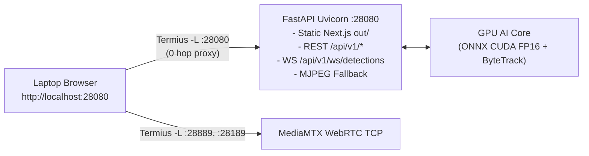
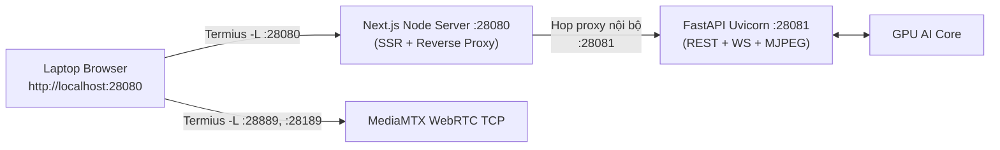

# Brainstorm Kiến trúc Frontend — Chuyển đổi sang Next.js trên Server GPU `aiot` (Termius Port Forwarding & Độ trễ BBox)

> **Bối cảnh**:
> - Yêu cầu từ khách hàng ngày càng mở rộng (nhiều bài toán AI: Bảo hộ lao động, Vùng máy tăng trọng, Chốt trực bảo vệ, Ra/vào kho lạnh & té ngã; mở rộng Dashboard, lịch sử cảnh báo, thống kê...). Frontend HTML/CSS/JS thuần sẽ nhanh chóng khó bảo trì khi quy mô tăng.
> - **Ràng buộc hạ tầng bắt buộc trên server chung `aiot` (`192.168.1.170`, RTX A400 4GB VRAM)**:
>   1. Chạy qua **`uv`**, **không dùng `tmux` chạy ngầm lung tung**, bấm **`Ctrl + C`** phải dừng và giải phóng sạch **100% tiến trình + port + VRAM**.
>   2. Kế thừa nguyên bộ **3 rule Termius Local Port Forwarding** sẵn có (`28080`, `28889`, `28189`), ưu tiên **1 lệnh duy nhất, 1 cửa sổ Termius**.
>   3. **Độ trễ BBox & HUD phải cực thấp** (15–25 FPS bám sát luồng video WebRTC/MJPEG).

---

## 1. So sánh 2 Phương án Vận hành Next.js trên Server `aiot`

### Phương án 1: Next.js Static Export (`output: 'export'`) → FastAPI phục vụ trực tiếp trên cổng `28080` *(Khuyến nghị)*

- **Cách hoạt động**:
  - Cấu hình `next.config.ts` với `output: 'export'` và `images: { unoptimized: true }`.
  - Khi build (`npm run build` / `pnpm build`), Next.js biên dịch toàn bộ ứng dụng React + TypeScript + Tailwind thành bộ file tĩnh tại `poc/frontend/out/`.
  - FastAPI (`app/main.py`) mount trực tiếp `poc/frontend/out/` tại `/` trên đúng cổng **`28080`** (kèm fallback SPA/App Router về `index.html`).
  - Khi **dev UI trên laptop local**: vẫn chạy `npm run dev` / `pnpm dev` ở `localhost:3000` (Hot Reload tức thì) kèm `rewrites` proxy `/api/v1/*` về `127.0.0.1:28080`.
  - Khi **chạy trên server `aiot`**: chỉ build 1 lần ra `out/` (hoặc build sẵn ở local rồi đồng bộ lên `aiot`), sau đó chạy **1 lệnh duy nhất** `./scripts/run_server.sh` (`uv run uvicorn ... --port 28080`).

- **Ưu điểm**:
  - **Chỉ 1 tiến trình duy nhất** (`uv run uvicorn`), **1 cửa sổ Termius**, **1 lệnh chạy**.
  - **`Ctrl + C` sạch tuyệt đối 100%** — không phát sinh tiến trình Node.js cần đồng bộ tắt.
  - **0 MB RAM / CPU bị chiếm bởi Node.js** lúc vận hành trên server chung `aiot`.
  - **0 hop proxy trung gian** cho WebSocket BBox và MJPEG → **độ trễ BBox thấp nhất**.
  - **0 lỗi CORS** vì UI, REST API và WebSocket dùng chung origin `http://localhost:28080`.
  - Giữ nguyên 100% 3 rule Termius (`28080 / 28889 / 28189`).
  - Có thể build `poc/frontend/out/` ngay trên laptop Windows rồi copy/git lên `aiot` nếu `aiot` không muốn cài Node.js.
- **Nhược điểm / Giới hạn**:
  - Không dùng được Next.js SSR động, Server Actions hay Next.js API Routes. *(Thực tế **không ảnh hưởng**, vì toàn bộ API, WebSocket, Auth, Database đều đã do FastAPI Backend đảm nhiệm đúng kiến trúc tách lớp).*
  - Mỗi lần sửa code Frontend cần chạy lại `build` (~5–15 giây) để cập nhật bản chạy trên `aiot` (khi dev local vẫn có Hot Reload bình thường).

---

### Phương án 2: Chạy song song Node.js (`next start`) + FastAPI (Gói trong 1 script khởi chạy)

- **Cách hoạt động**:
  - Chạy đồng thời **2 tiến trình** trên `aiot`:
    - **Next.js server** (`next start -p 28080`) đóng vai trò cổng vào duy nhất, cấu hình `rewrites` chuyển tiếp `/api/v1/*` và `/api/v1/ws/*` sang FastAPI chạy ở cổng nội bộ `127.0.0.1:28081` *(hoặc ngược lại: FastAPI ở `28080` proxy UI sang Next.js ở `127.0.0.1:3000`)*.
  - Bọc cả 2 tiến trình trong 1 script `run_server.sh` có `trap 'kill 0' INT TERM EXIT` để cố gắng dừng cả 2 khi bấm `Ctrl + C`.

- **Ưu điểm**:
  - Dùng được đầy đủ tính năng server-side của Next.js (SSR động, Server Components fetch dữ liệu phía server, Middleware auth tại tầng Next.js).
  - Vẫn có thể gom vào 1 lệnh chạy trên 1 cửa sổ Termius (thông qua shell script bọc 2 process).
- **Nhược điểm**:
  - **Tốn thêm ~200–400 MB RAM** thường trực cho tiến trình Node.js trên server chung `aiot`.
  - **Thêm 1 hop proxy trung gian** cho WebSocket BBox và luồng MJPEG `StreamingResponse`:
    - Tăng độ trễ serialize/forward cho từng gói tin BBox (15–25 msg/s).
    - Next.js `rewrites` mặc định có giới hạn timeout và cơ chế buffering dễ làm **treo hoặc ngắt sớm luồng MJPEG / WebSocket dài hạn**.
  - **Quản lý `Ctrl + C` phức tạp hơn**: phải quản lý đồng thời 2 cây tiến trình độc lập (Node.js + Python/Uvicorn/FFmpeg/MediaMTX), tăng rủi ro sót tiến trình mồ côi nếu 1 trong 2 crash.
  - Bắt buộc cài Node.js runtime đúng phiên bản trên server `aiot`.

---

### Bảng đối chiếu nhanh 2 Phương án

| Tiêu chí | Phương án 1: `output: 'export'` trên FastAPI `:28080` | Phương án 2: `next start` + FastAPI (2 process) |
| :--- | :---: | :---: |
| **Độ trễ BBox (Network)** | ⭐⭐⭐⭐⭐ **Tối ưu (0 hop proxy)** | ⭐⭐⭐ Kém hơn (thêm 1 hop Node proxy) |
| **Ổn định WebSocket & MJPEG** | ⭐⭐⭐⭐⭐ Kết nối thẳng Uvicorn | ⭐⭐ Dễ bị proxy buffering / timeout |
| **1 lệnh duy nhất, 1 cửa sổ Termius** | ✅ Tự nhiên (chỉ 1 tiến trình `uv`) | ⚠️ Cần shell wrapper quản lý 2 tiến trình |
| **`Ctrl + C` dừng sạch 100%** | ✅ Tuyệt đối sạch (1 cây tiến trình + `PR_SET_PDEATHSIG`) | ⚠️ Phức tạp, dễ sót Node process |
| **RAM/CPU chiếm trên `aiot`** | ✅ **0 MB** cho Node lúc chạy | ❌ +200–400 MB RAM cho Node.js |
| **Hỗ trợ SSR / Server Actions** | ❌ Không (không cần do đã có FastAPI) | ✅ Có |
| **Khả năng mở rộng UI (React/TS/Tailwind)** | ✅ **100% đầy đủ** | ✅ 100% đầy đủ |

---

## 2. Phân tích Chuyên sâu: Làm sao để Next.js KHÔNG gây chậm BBox trên Trình duyệt?

Ngoài tầng mạng (nơi **Phương án 1** thắng tuyệt đối), **tầng render trình duyệt** là yếu tố quyết định liệu Next.js có vẽ BBox mượt ngang HTML/JS thuần hay không.

### 2.1. Cạm bẫy kinh điển gây giật/chậm BBox trong React/Next.js
Nếu lưu payload WebSocket (15–25 gói/giây chứa mảng `persons[]` với tọa độ thay đổi liên tục) trực tiếp vào `useState(detections)` ở component trang Live View:
- Mỗi giây React phải chạy Virtual DOM diffing & re-render toàn bộ lưới `CameraCard` **15–25 lần/giây**.
- Trình duyệt vừa giải mã WebRTC/MJPEG, vừa diff DOM liên tục → main thread bị nghẽn → **BBox bị trễ pha và giật khung hình**.

### 2.2. Kiến trúc Dual-Speed Rendering (Nhanh ngang 100% Vanilla JS)

Tách hoàn toàn dữ liệu WebSocket thành **2 luồng cập nhật với tần số khác nhau**:

1. **Luồng Tốc độ Cao — 15–25 FPS (0 lần React Re-render)**:
   - Dùng một **External Store nhẹ (pub-sub)** ngoài React (hoặc `useRef`) để giữ `latestDetections[camId]`.
   - Component `<CameraOverlayCanvas camId={cam.id} zone={cam.zone} />` mount **1 lần duy nhất**, đăng ký listener trực tiếp vào store và gọi vẽ `<canvas>` qua **`requestAnimationFrame`**.
   - Kết quả: Khi có 25 gói BBox/giây đổ về, **React re-render = 0**, thời gian vẽ Canvas `< 1–2 ms`, bám khít chuyển động nhân viên tương đương 100% JS thuần.
2. **Luồng Tốc độ Thấp — ~1 Hz (React State cho HUD & Viền cảnh báo)**:
   - Component `<ZoneHudOverlay camId={cam.id} />` chỉ gọi `setState` khi một trong các giá trị hiển thị **thực sự đổi**:
     - `status` / `ui_color` (`green` / `yellow` / `red`)
     - `sub_label` (đổi mỗi giây: `00:02` → `00:03`, hoặc `1 người trong vùng` → `Vừa rời khỏi vùng`)
     - `alert_count` / `total_alert_seconds` (đổi theo giây khi ở trạng thái đỏ)
     - `timeline` (cập nhật nhẹ)
   - Kết quả: DOM của HUD chỉ cập nhật tối đa **~1 lần/giây**, cực kỳ nhẹ và mượt.

---

## 3. Kết luận & Khuyến nghị (Đã Triển Khai Chính Thức Trong PoC v001)

- **Kiến trúc đã chốt & triển khai**:
  1. Chọn **Phương án 1 — Next.js 15 (App Router + TypeScript + Tailwind CSS) với `output: 'export'`**, để **FastAPI phục vụ trực tiếp thư mục `out/` trên cổng `28080`**, kết hợp **Dual-Speed Rendering (`ref + rAF` cho Canvas BBox, `state` 1 Hz cho HUD)**.
  2. **Đóng gói Docker Multi-Stage tại thư mục gốc `poc/` ([poc/Dockerfile](file:///e:/ATIN/atin_tran_han_industry/poc/Dockerfile) + [poc/docker-compose.yml](file:///e:/ATIN/atin_tran_han_industry/poc/docker-compose.yml))**:
     - Stage 1 (`node:20-alpine`) build tĩnh Next.js; Stage 2 (`nvidia/cuda:12.4.1-cudnn-runtime-ubuntu22.04`) chạy FastAPI + `onnxruntime-gpu` CUDA 12 trên đúng cổng `28080`, ánh xạ thẳng ra domain công ty **`https://tranhan.atin.vn/`**.
  3. **Xem bộ đặc tả chi tiết đầy đủ tại**: [poc/docs/pocv001/](file:///e:/ATIN/atin_tran_han_industry/poc/docs/pocv001) và hướng dẫn vận hành Docker tại [poc/docs/deploy.md](file:///e:/ATIN/atin_tran_han_industry/poc/docs/deploy.md).
