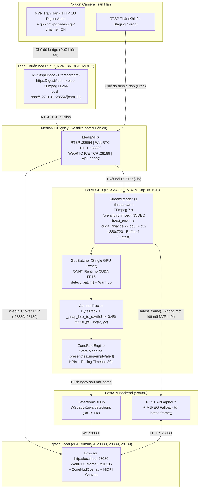

# Kế hoạch Thiết kế & Triển khai Chi tiết — Live View Giám sát Nhân viên trong Vùng Quy định

> **Tài liệu tham chiếu**:
> - Ảnh mẫu UI từ PM: `poc/frontend/requirment/{CoNhanVien.jpg, VungTrong.jpg, KhongCoNhanVien.jpg}`
> - Tài liệu vận hành & kỹ thuật server `aiot` (`192.168.1.170`, RTX A400 4GB VRAM):
>   - [DEEP_DIVE_AI_CORE.md](file:///E:/ATIN/atin_tran_han_industry/docs/note/DEEP_DIVE_AI_CORE.md)
>   - [DEEP_DIVE_BACKEND_FRONTEND_STAGING.md](file:///E:/ATIN/atin_tran_han_industry/docs/note/DEEP_DIVE_BACKEND_FRONTEND_STAGING.md)
>   - [INFRA_AIOT_TERMIUS_PORTS.md](file:///E:/ATIN/atin_tran_han_industry/docs/note/INFRA_AIOT_TERMIUS_PORTS.md)
>   - [TECHNICAL_REPORT.md](file:///E:/ATIN/atin_tran_han_industry/docs/note/TECHNICAL_REPORT.md)
>
> **Mục đích tài liệu**: Đóng vai trò **Implementation Blueprint** hoàn chỉnh. Khi triển khai, đọc trực tiếp từng mục và triển khai chính xác theo interface, cấu hình, thuật toán và thứ tự Phase bên dưới.

---

## 1. Mục tiêu & Quy tắc Nghiệp vụ (Business Rules)

Chuyển đổi hệ thống PoC từ bài toán "xâm nhập vùng cấm" sang bài toán **giám sát duy trì nhân viên trong vùng quy định** (Vùng máy trộn / Tăng trọng / Chốt bảo vệ) chạy mượt thời gian thực trên **Server GPU `aiot` (NVIDIA RTX A400 — 4GB VRAM)** và xem Live View từ laptop local qua **Termius Port Forwarding** (kế thừa nguyên bộ port của dự án trước).

### 1.1. Bảng ánh xạ 4 Trạng thái Nội bộ → 3 Màu UI

| Trạng thái (`status`) | Màu UI (`ui_color`) | Mã màu | Nhãn chính (`status_label`) | Nhãn phụ (`sub_label`) | Tag trên Polygon | Điều kiện chuyển đổi |
| :--- | :--- | :---: | :--- | :--- | :--- | :--- |
| `present` | 🟢 `green` | `#22c55e` | **CÓ NHÂN VIÊN** | `{N} người trong vùng` | `{TÊN VÙNG} · {N} NV` | `in_zone_count >= 1` |
| `leaving` | 🟢 `green` | `#22c55e` | **CÓ NHÂN VIÊN** | `Vừa rời khỏi vùng` | `{TÊN VÙNG} · VỪA RỜI VÙNG` | Vừa chuyển từ `present` sang `in_zone_count == 0`, và `empty_duration < grace_seconds` (`2.0s`) |
| `empty` | 🟡 `yellow` | `#f59e0b` | **VÙNG TRỐNG** | `không có người {MM:SS}` | `{TÊN VÙNG} · TRỐNG` | Cold start (chưa thấy người) hoặc mất dấu từ `leaving` đạt `>= grace_seconds` (`2.0s`), và thời gian ở trạng thái vàng `< warning_seconds` (`10.0s`) |
| `alert` | 🔴 `red` | `#ef4444` | **KHÔNG CÓ NHÂN VIÊN** | `Cảnh báo · vùng trống {MM:SS}` | `{TÊN VÙNG} · KHÔNG CÓ NHÂN VIÊN` | Ở trạng thái `empty` đủ `>= warning_seconds` (`10.0s`, tức tổng `00:12` nếu đi từ `present` -> `leaving` -> `empty` -> `alert`) + **viền khung viewport sáng đỏ** |

### 1.2. Các quyết định thiết kế đã chốt

1. **Cold Start**: Khởi tạo ở **`empty` (Màu vàng — Vùng trống)**, đếm `00:00` → `00:10` rồi chuyển Đỏ (`alert`). Trạng thái `leaving` (`"Vừa rời khỏi vùng"`) **chỉ xuất hiện** khi mất dấu từ `present`.
2. **Timeline trên Live View**: **Cửa sổ trượt 30 phút gần nhất** (`AI_TIMELINE_WINDOW_SECONDS=1800`), gộp các đoạn cùng màu liền kề.
3. **Điểm neo kiểm tra vùng (Anchor Point)**: **Điểm chân — chính giữa cạnh đáy bbox `(foot_x, foot_y) = ((x1 + x2) / 2, y2)`** giống chấm tròn trắng-xanh dưới chân nhân viên trong `CoNhanVien.jpg`.
4. **BBox nhân viên ngoài vùng**: **Vẽ cả nhân viên ngoài vùng ở dạng làm mờ** (`globalAlpha = 0.42`, viền mảnh `1.25px` màu `#94a3b8`, nhãn nhỏ `#{track_id}`), trong khi nhân viên trong vùng vẽ nổi bật màu xanh lá `#22c55e` với nhãn `Nhân viên #{track_id}`.
5. **GPU Inference**: Dùng **`onnx_cuda` (`onnxruntime-gpu` + `CUDAExecutionProvider`)** với model **FP16** (`poc/models/yolo26s_fp16.onnx` chuyển đổi 1 lần từ `yolo26s.onnx` bằng `convert_onnx_fp16.py`), **giới hạn cứng VRAM `<= 1024 MB`** (`gpu_mem_limit` + `kSameAsRequested`), **0% `ultralytics`**. Fallback tự động về `onnx_cpu` trên laptop Windows.
6. **Kế thừa nguyên hạ tầng Port & Termius của dự án `traffic_congestion_evaluation`**: Giữ nguyên bộ port **`28080` / `28554` / `28889` / `28189` / `29997`** để dùng lại ngay 3 rule Port Forwarding sẵn có trên Termius, không cấu hình lại.
7. **Chuẩn hóa luồng video qua RTSP + MediaMTX (có Bridge từ NVR HTTP MJPEG)**: Dùng `NvrRtspBridge` chuyển luồng HTTP MJPEG Digest Auth từ tài khoản NVR Trần Hân (`nmts2025.smartddns.tv:80`) thành luồng **RTSP H.264 nội bộ trên MediaMTX (`rtsp://127.0.0.1:28554/{cam_id}`)**. Toàn bộ pipeline phía sau (`StreamReader` NVDEC, WebRTC qua Termius, AI Core) chạy chuẩn RTSP 100% — khi lên Production chỉ cần tắt Bridge và trỏ `rtsp_url` thật.

---

## 2. Kiến trúc End-to-End & Sơ đồ Luồng



---

## 3. Hạ tầng Server `aiot`, Ma trận Port Kế thừa & Termius

### 3.1. Ma trận Port (Dùng chung nguyên bộ port từ `traffic_congestion_evaluation`)

> [!IMPORTANT]
> **Quy tắc vận hành trên server chung `aiot`**:
> 1. Nếu dự án cũ đang chạy ngầm bằng `tmux`, dừng sạch trước (`tmux ls` → `tmux kill-session -t <name>`).
> 2. Dự án Trần Hân **KHÔNG chạy ngầm bằng `tmux`**; luôn chạy trực tiếp qua **`uv run`** để khi bấm **`Ctrl + C`** sẽ dừng và giải phóng **100% tiến trình, port và VRAM GPU** ngay lập tức (không để sót `ffmpeg` / `mediamtx` mồ côi trên server chung).

| Port (TCP) | Thành phần | Bind trên `aiot` | Biến `.env` | Chức năng |
| :---: | :--- | :--- | :--- | :--- |
| **`28080`** | FastAPI + Uvicorn | `0.0.0.0:28080` | `PORT=28080` | Web UI (`/`), REST API (`/api/v1/*`), **WebSocket (`/api/v1/ws/detections`)**, MJPEG Fallback (`/api/v1/cameras/{id}/mjpeg`) |
| **`28554`** | MediaMTX (RTSP) | `:28554` | `MEDIAMTX_RTSP_PORT=28554` | Điểm nhận publish từ `NvrRtspBridge` & nguồn RTSP nội bộ (`rtsp://127.0.0.1:28554/{cam_id}`) cho `StreamReader` |
| **`28889`** | MediaMTX (WebRTC HTTP) | `:28889` | `MEDIAMTX_WEBRTC_PORT=28889` | Trang WebRTC player & HTTP/WHEP signaling (`http://localhost:28889/{cam_id}/`) |
| **`28189`** | MediaMTX (WebRTC ICE TCP) | `:28189` | `MEDIAMTX_ICE_TCP_PORT=28189` | Kênh truyền media WebRTC qua **TCP** (đi lọt SSH Tunnel) |
| **`29997`** | MediaMTX (Control API) | `127.0.0.1:29997` | `MEDIAMTX_API_PORT=29997` | API quản trị nội bộ MediaMTX |

### 3.2. Cấu hình Termius (Giữ nguyên 3 rule `-L` sẵn có)

| Type | Local Port | Destination Host | Destination Port | Mục đích |
| :-: | :-: | :-: | :-: | :--- |
| **Local** | `28080` | `127.0.0.1` | `28080` | Web UI, REST API, WebSocket `/api/v1/ws/detections`, MJPEG fallback |
| **Local** | `28889` | `127.0.0.1` | `28889` | MediaMTX WebRTC HTTP/WHEP iframe |
| **Local** | `28189` | `127.0.0.1` | `28189` | MediaMTX WebRTC ICE media qua TCP |

Lệnh CLI tương đương:
```powershell
ssh -L 28080:127.0.0.1:28080 -L 28889:127.0.0.1:28889 -L 28189:127.0.0.1:28189 tts@192.168.1.170
```

### 3.3. Quy trình chuẩn bị & khởi chạy trên `aiot` (Ubuntu 22.04, RTX A400 4GB)

```bash
# 1. Thoát Conda base, dọn tmux cũ (nếu có), kiểm tra GPU & port
conda deactivate 2>/dev/null || true
tmux ls 2>/dev/null || true          # nếu có session dự án cũ -> tmux kill-session -t <name>
nvidia-smi
ss -tulpn | grep -E "28080|28554|28889|28189" || true

# 2. Thiết lập .venv cô lập + cài GPU extras (chỉ chạy 1 lần)
cd ~/projects/<user>/atin_tran_han_industry/poc/backend
uv venv .venv --python 3.12
uv pip install --python .venv/bin/python -e ".[dev,gpu]"

# 3. Đặt FFmpeg 7.x BtbN GPL static build & MediaMTX binary vào .venv/bin/ (không đụng /usr/bin)
.venv/bin/ffmpeg -version | head -n 1
.venv/bin/mediamtx --version

# 4. Convert model sang FP16 (chỉ chạy 1 lần)
uv run --no-sync python scripts/convert_onnx_fp16.py

# 5. Chạy trực tiếp qua uv (foreground, KHÔNG dùng tmux — Ctrl+C dừng sạch toàn bộ!)
./scripts/run_server.sh
# Tương đương:
# uv run --no-sync uvicorn app.main:app --host 0.0.0.0 --port 28080 --timeout-graceful-shutdown 2
```
Sau đó mở trình duyệt trên laptop tại **`http://localhost:28080`**.

### 3.4. Cơ chế Clean Shutdown Tuyệt đối khi bấm `Ctrl + C` (Chống tiến trình mồ côi trên server chung)

Để đảm bảo bấm **`Ctrl + C`** dừng sạch 100% toàn bộ hệ thống trong `<= 3 giây` (không còn sót bất kỳ process `python`, `ffmpeg`, `mediamtx` nào chiếm VRAM/CPU/port trên `aiot`), áp dụng đồng thời **4 lớp bảo vệ**:
1. **Chạy trực tiếp qua `uv` + `exec` trong `run_server.sh`**: `exec uv run --no-sync uvicorn app.main:app --host 0.0.0.0 --port "${PORT:-28080}" --timeout-graceful-shutdown 2` — `SIGINT` từ `Ctrl + C` đi thẳng tới Uvicorn, ép ngắt các kết nối streaming (MJPEG/WebSocket) sau tối đa `2s` để kích hoạt `lifespan` shutdown ngay lập tức.
2. **Bảo vệ ở mức Linux Kernel (`PR_SET_PDEATHSIG`)**: Viết helper `app/utils/process.py` gắn `preexec_fn` gọi `libc.prctl(PR_SET_PDEATHSIG, signal.SIGKILL)` cho **mọi subprocess** (`mediamtx`, `ffmpeg` trong `StreamReader`, `ffmpeg` trong `NvrRtspBridge`). Ngay cả khi Python bị crash hoặc `kill -9`, Linux Kernel tự động tiêu diệt tức thì toàn bộ tiến trình con, **0% khả năng sót zombie**.
3. **Thứ tự Shutdown tuần tự trong FastAPI `lifespan`**:
   - `await ws_hub.close_all()` (ngắt toàn bộ WebSocket client)
   - `detection_service.stop()` (dừng `GpuBatcher` + `kill()` & `wait(2s)` toàn bộ `ffmpeg` của `StreamReader`)
   - `nvr_bridge.stop()` (đóng `httpx` stream + `kill()` & `wait(2s)` toàn bộ `ffmpeg` bridge)
   - `mediamtx.stop()` (`terminate()` + `wait(3s)` + `kill()`)
4. **Lưới an toàn `atexit`**: Đăng ký cleanup handler cho mọi subprocess đang quản lý để phòng trường hợp thoát bất thường ngoài `lifespan`.

---

## 4. Chi tiết Thiết kế Kỹ thuật từng Module (Implementation Blueprint)

### 4.1. Script chuyển đổi ONNX FP16 Offline
#### [NEW] [convert_onnx_fp16.py](file:///E:/ATIN/atin_tran_han_industry/poc/backend/scripts/convert_onnx_fp16.py)
- Đọc `poc/models/yolo26s.onnx` (FP32) → dùng `onnxconverter_common.float16.convert_float_to_float16(model, keep_io_types=True)` → lưu `poc/models/yolo26s_fp16.onnx`.
- **Quan trọng**: `keep_io_types=True` giữ tensor đầu vào/đầu ra ở `float32` để toàn bộ `_preprocess` / `_postprocess` (NMS) không cần sửa và không bị sai số tọa độ box, trong khi toàn bộ trọng số Conv/MatMul bên trong chạy **FP16 trên Tensor Cores của RTX A400** (giảm ~50% VRAM và tăng tốc ~1.7–2x).
- In ra dung lượng file trước/sau và verify load thử bằng `onnxruntime.InferenceSession`.

---

### 4.2. MediaMTX Service & NVR HTTP-MJPEG → RTSP Bridge

#### [NEW] [mediamtx_service.py](file:///E:/ATIN/atin_tran_han_industry/poc/backend/app/services/mediamtx_service.py)
- Tìm binary `mediamtx` ưu tiên trong `Path(sys.executable).parent` (`.venv/bin/mediamtx`), rồi `MEDIAMTX_BIN`, rồi `PATH`.
- Sinh file cấu hình động `poc/backend/logs/mediamtx.yml` từ `BASE_CONFIG`:
  ```python
  BASE_CONFIG = {
      "logLevel": "info",
      "api": True,
      "apiAddress": f"127.0.0.1:{settings.MEDIAMTX_API_PORT}",
      "rtsp": True,
      "rtspAddress": f":{settings.MEDIAMTX_RTSP_PORT}",
      "protocols": ["tcp"],
      "rtmp": False,
      "hls": False,
      "srt": False,
      "webrtc": True,
      "webrtcAddress": f":{settings.MEDIAMTX_WEBRTC_PORT}",
      "webrtcLocalUDPAddress": "",
      "webrtcLocalTCPAddress": f":{settings.MEDIAMTX_ICE_TCP_PORT}",
      "webrtcIPsFromInterfaces": False,
      "webrtcAdditionalHosts": settings.MEDIAMTX_WEBRTC_HOSTS,  # ["127.0.0.1"]
      "webrtcAllowOrigin": "*",
  }
  ```
- Quy tắc sinh `paths` theo từng camera (`enabled == True`):
  - Nếu camera có `rtsp_url` (hoặc `NVR_BRIDGE_MODE == "direct_rtsp"`):
    ```yaml
    ch18:
      source: rtsp://...
      rtspTransport: tcp
      sourceOnDemand: false
    ```
  - Nếu `NVR_BRIDGE_MODE == "http_mjpeg_bridge"` (mặc định với NVR Trần Hân chỉ có HTTP :80):
    ```yaml
    ch18:
      source: publisher
    ```
    (cho phép `NvrRtspBridge` push luồng H.264 vào `rtsp://127.0.0.1:28554/ch18`).
- Vòng đời: `start()` + chờ `1.5s` cho cổng `28554` sẵn sàng, daemon thread `_pump_logs` đọc stdout/stderr, `reload(cameras)` khi thêm/sửa/xóa camera, `stop()` (`terminate()` + `wait(5s)` + `kill()`).

#### [NEW] [nvr_rtsp_bridge.py](file:///E:/ATIN/atin_tran_han_industry/poc/backend/app/services/nvr_rtsp_bridge.py)
- Giải quyết triệt để vấn đề **NVR Trần Hân chỉ cung cấp HTTP :80 Digest Auth** (mật khẩu có `@`) mà không mở cổng RTSP `554`:
- Quản lý 1 daemon thread `bridge-{cam_id}` cho mỗi camera `enabled` khi `NVR_BRIDGE_MODE == "http_mjpeg_bridge"`:
  1. Dùng `httpx.Client(auth=httpx.DigestAuth(user, pass), timeout=httpx.Timeout(10.0, read=15.0))` mở stream `GET {nvr_base_url}/cgi-bin/mjpg/video.cgi?channel={channel}&subtype={subtype}` — **chắc chắn 100% vượt qua Digest Auth của Dahua NVR**, không bị lỗi auth của FFmpeg.
  2. Tách từng khung hình JPEG từ luồng multipart (`\xff\xd8` ... `\xff\xd9`).
  3. Mở tiến trình con FFmpeg (ưu tiên `.venv/bin/ffmpeg`) nhận JPEG qua `stdin` (`pipe:0`) và push H.264 sang MediaMTX:
     ```bash
     ffmpeg -nostdin -hide_banner -loglevel error \
       -f mjpeg -framerate 15 -i pipe:0 \
       -vf "scale=1280:720:force_original_aspect_ratio=decrease,pad=1280:720:(ow-iw)/2:(oh-ih)/2" \
       -c:v libx264 -preset ultrafast -tune zerolatency -pix_fmt yuv420p -g 30 -b:v 1500k \
       -f rtsp -rtsp_transport tcp rtsp://127.0.0.1:28554/{cam_id}
     ```
     *(Lưu ý: dùng `libx264 -preset ultrafast -tune zerolatency` cho bridge để **dành 100% VRAM GPU RTX A400 cho NVDEC + ONNX FP16**; có tùy chọn `BRIDGE_VIDEO_CODEC=h264_nvenc` qua `.env` nếu muốn offload encode sang NVENC).*
  4. Tự động reconnect sau `2.0s` nếu NVR ngắt kết nối hoặc FFmpeg thoát; dọn sạch `proc.kill()` + `proc.wait(2.0)` khi `stop()`.
  5. Hàm `sync_cameras(cameras)`: khi user thêm/sửa/xóa camera trên UI, tự khởi động/dừng thread bridge tương ứng.

---

### 4.3. StreamReader — FFmpeg CUDA/NVDEC (Phòng chống toàn bộ lỗi `go2rtc` / `aiot`)

#### [NEW] [stream_reader.py](file:///E:/ATIN/atin_tran_han_industry/poc/backend/app/ai/stream_reader.py)
- Bám sát 100% mã nguồn đã kiểm chứng trên server `aiot` trong [DEEP_DIVE_AI_CORE.md](file:///E:/ATIN/atin_tran_han_industry/docs/note/DEEP_DIVE_AI_CORE.md#L128-L310):
  - Thiết lập biến môi trường mặc định cho OpenCV fallback:
    ```python
    os.environ.setdefault(
        "OPENCV_FFMPEG_CAPTURE_OPTIONS",
        "rtsp_transport;tcp|fflags;nobuffer|flags;low_delay|probesize;32768|analyzeduration;0|stimeout;5000000",
    )
    ```
  - `_resolve_ffmpeg_bin()`: tìm `shutil.which("ffmpeg", path=str(Path(sys.executable).parent)) or shutil.which("ffmpeg")` để ưu tiên `.venv/bin/ffmpeg` (FFmpeg 7.x BtbN GPL build).
  - `FramePacket(frame: np.ndarray, seq: int, t_mono: float)` lưu trong `self._latest` dưới `self._lock` (`buffer = 1`).
  - `_build_ffmpeg_cmd(mode, ffmpeg_bin)`:
    - `probe = "1000000" if mode == "cuda_hwaccel" else "500000"` *(chống kẹt probe keyframe 2K)*.
    - Flags bắt buộc: `-nostdin -hide_banner -loglevel error -rtsp_transport tcp -fflags nobuffer -flags low_delay -strict experimental -probesize {probe} -analyzeduration {probe}`.
    - Nhánh `h264_cuvid` / `hevc_cuvid`: `-hwaccel cuda -c:v {mode} -resize {w}x{h} -i {url} -an -sn -f rawvideo -pix_fmt bgr24 pipe:1`.
    - Nhánh `cuda_hwaccel` / `ffmpeg_cpu`: `["-hwaccel", "cuda"]` (nếu `cuda_hwaccel`, **KHÔNG ép `-c:v`** trước `-i`), `-i {url} -an -sn -vf scale={w}:{h}:flags=fast_bilinear -f rawvideo -pix_fmt bgr24 pipe:1`.
  - `_read_frame_bytes(pipe, frame_bytes)`:
    - Trên Linux (`os.name != "nt"`): dùng `select.select([fd], [], [], min(remaining, 0.5))` + `os.read(fd, frame_bytes - len(buf))` với `deadline = time.monotonic() + self.timeout_s` (`timeout_s = 5.0`) — **không bao giờ treo vô thời hạn**.
    - Trên Windows (`os.name == "nt"`): `pipe.read(frame_bytes)`.
  - `_run_ffmpeg()`:
    - Thử tuần tự `modes = ["h264_cuvid", "cuda_hwaccel", "hevc_cuvid", "ffmpeg_cpu"]` (cho phép override qua `AI_RTSP_FFMPEG_MODES`).
    - Mở `subprocess.Popen(cmd, stdin=subprocess.DEVNULL, stdout=subprocess.PIPE, stderr=subprocess.PIPE, bufsize=0)`.
    - Đọc liên tục để xả OS pipe buffer; chỉ `.reshape((h, w, 3)).copy()` và gọi `_emit_frame()` khi `now - last_emit >= interval - 0.003`.
    - `finally`: luôn `proc.kill()` + `proc.wait(timeout=2.0)` tránh zombie chiếm slot NVDEC.
    - Nếu `not got_frame`: đọc `proc.stderr`, ghi log warning rõ ràng và tăng `mode_idx += 1` (tối đa sau 5s rơi sang `cuda_hwaccel` vẫn giữ giải mã NVDEC); hết list thì fallback sang `_run_opencv()` (`CAP_PROP_BUFFERSIZE=1`, tách `cap.grab()` và `cap.retrieve()`).
  - Public API: `start()`, `stop()`, `latest() -> FramePacket | None`, `latest_frame() -> np.ndarray | None`, `is_alive_stream() -> bool` (`now - last_frame_mono < 5.0`).

---

### 4.4. Detector — ONNX Runtime CUDA FP16 + VRAM Cap + GPU Micro-Batching

#### [MODIFY] [detector.py](file:///E:/ATIN/atin_tran_han_industry/poc/backend/app/ai/detector.py)
- **0% `ultralytics`** — thuần `onnxruntime` + `cv2` + `numpy`.
- `PersonDetection` dataclass mở rộng thêm `foot_x: float`, `foot_y: float` (`foot_x = cx`, `foot_y = ny2`).
- Cấu hình provider trong `ensure_session()`:
  - Khi `runtime in ("auto", "onnx_cuda")` và `"CUDAExecutionProvider"` có trong `ort.get_available_providers()`:
    ```python
    cuda_options = {
        "device_id": 0,
        "arena_extend_strategy": "kSameAsRequested",
        "gpu_mem_limit": int(self.vram_limit_mb * 1024 * 1024),  # mặc định 1024 MB trên A400 4GB
        "cudnn_conv_algo_search": "HEURISTIC",
        "do_copy_in_default_stream": True,
    }
    providers = [("CUDAExecutionProvider", cuda_options), "CPUExecutionProvider"]
    ```
  - Ngược lại fallback mượt về `["CPUExecutionProvider"]` (có log rõ đang chạy `CUDA` hay `CPU` + file model `.onnx`).
- Tự động ưu tiên `yolo26s_fp16.onnx` nếu tồn tại cạnh `yolo26s.onnx` và đang chạy CUDA (hoặc dùng đúng `MODEL_PATH` trong `.env`).
- **`warmup()`**: chạy 1 pass dummy `np.zeros((1, 3, imgsz, imgsz), dtype=np.float32)` ngay khi `ensure_session()`.
- **`detect_batch(frames: list[np.ndarray]) -> list[list[PersonDetection]]`**:
  - Kiểm tra xem input shape của ONNX model có hỗ trợ dynamic batch (`shape[0]` là `str` / `None` / `-1`) không:
    - Nếu dynamic batch: stack `np.concatenate(blobs, axis=0)` → **1 lời gọi `session.run()` duy nhất** cho cả N camera.
    - Nếu model export cố định batch=1 (`shape[0] == 1`): tự động chạy vòng lặp từng frame trên cùng CUDA session (không crash!).
  - Giữ `detect(frame)` gọi `detect_batch([frame])[0]` để tương thích ngược 100% với unit tests hiện có.

---

### 4.5. Tracker — ByteTrack + IoU Snap khử trễ pha Kalman

#### [NEW] [tracker.py](file:///E:/ATIN/atin_tran_han_industry/poc/backend/app/ai/tracker.py)
- Dataclass `TrackedPerson(track_id: int, x1: float, y1: float, x2: float, y2: float, cx: float, cy: float, foot_x: float, foot_y: float, conf: float)` (tất cả tọa độ chuẩn hóa `[0..1]`).
- Hàm `_snap_box_to_raw(track_box: np.ndarray, raw_boxes: np.ndarray, min_iou: float = 0.45) -> np.ndarray` (bám sát mã nguồn trong `DEEP_DIVE_AI_CORE.md` mục 5.2).
- Class `CameraTracker`:
  - Khởi tạo `sv.ByteTrack(track_activation_threshold=0.25, lost_track_buffer=30, minimum_matching_threshold=0.8, frame_rate=15)` (chạy trên hệ tọa độ ảo `1000x1000` hoặc `1280x720` rồi chia ngược về `[0..1]` vì Kalman Filter của ByteTrack nhạy với scale pixel).
  - Sau `bt.update_with_detections(sv_dets)`: gọi `_snap_box_to_raw()` cho từng track để khử trễ pha Kalman, giữ nguyên `track_id`, tính `foot_x = (x1 + x2) * 0.5`, `foot_y = y2`.
  - Quản lý dict `trackers[cam_id]` độc lập cho từng camera; hàm `reset(cam_id)` khi cần reset.

---

### 4.6. Rule Engine — State Machine 4 Trạng thái, KPIs & Rolling Timeline 30 phút

#### [MODIFY] [rule_engine.py](file:///E:/ATIN/atin_tran_han_industry/poc/backend/app/ai/rule_engine.py)
- Dataclass `TimelineSegment(start: float, end: float, color: Literal["green", "yellow", "red"])`.
- Dataclass `ZoneState`:
  - `status: str = "empty"` *(Cold start = `empty`, màu vàng)*
  - `empty_since: float | None = None` *(thời điểm bắt đầu không có người)*
  - `yellow_since: float | None = None` *(thời điểm bắt đầu vào màu vàng — dùng để đếm chính xác `10.0s` sang Đỏ cho cả Cold Start lẫn sau `leaving`)*
  - `state_changed_at_wall: float` *(epoch seconds cho Frontend)*
  - `last_eval_mono: float | None = None`
  - `last_event_at: float = 0.0`
  - `alert_count: int = 0`
  - `total_alert_seconds: float = 0.0`
  - `session_started_at_wall: float`
  - `timeline: deque[TimelineSegment]`
- **Thuật toán chuyển trạng thái chính xác (`feature_type == "zone_presence"`)**:
  1. Kiểm tra từng `TrackedPerson`: dùng `(p.foot_x, p.foot_y)` (khi `anchor_mode == "bottom_center"`) hoặc `(p.cx, p.cy)` vào `point_in_polygon`. Đếm `in_zone_count`.
  2. Tính `dt = max(0.0, ts - state.last_eval_mono)` (nếu `last_eval_mono` tồn tại). Nếu trạng thái trước đó là `"alert"`, cộng `state.total_alert_seconds += dt`.
  3. Xác định trạng thái mới:
     - **Nếu `in_zone_count > 0`**:
       - `new_status = "present"`
       - `state.empty_since = None`, `state.yellow_since = None`
     - **Nếu `in_zone_count == 0`**:
       - Nếu `state.empty_since is None`: `state.empty_since = ts`
       - Nếu trước đó đang ở `"present"`: chuyển sang `"leaving"` (`state.yellow_since = None`).
       - Nếu đang ở `"leaving"`:
         - Nếu `(ts - state.empty_since) >= grace_seconds` (`2.0s`): chuyển sang `"empty"`, đặt `state.yellow_since = ts`.
         - Ngược lại giữ `"leaving"`.
       - Nếu đang ở `"empty"`:
         - Nếu `state.yellow_since is None`: `state.yellow_since = ts` *(trường hợp Cold Start)*.
         - Nếu `(ts - state.yellow_since) >= warning_seconds` (`10.0s`): chuyển sang `"alert"`, tăng `state.alert_count += 1`, kiểm tra cooldown để bật `should_emit_event = True`.
         - Ngược lại giữ `"empty"`.
       - Nếu đang ở `"alert"`: giữ `"alert"`.
  4. **Ánh xạ UI Labels & Colors**:
     - `present` → `ui_color="green"`, `status_label="CÓ NHÂN VIÊN"`, `sub_label=f"{in_zone_count} người trong vùng"`
     - `leaving` → `ui_color="green"`, `status_label="CÓ NHÂN VIÊN"`, `sub_label="Vừa rời khỏi vùng"`
     - `empty` → `ui_color="yellow"`, `status_label="VÙNG TRỐNG"`, `sub_label=f"không có người {_fmt_mmss(empty_duration)}"`
     - `alert` → `ui_color="red"`, `status_label="KHÔNG CÓ NHÂN VIÊN"`, `sub_label=f"Cảnh báo · vùng trống {_fmt_mmss(empty_duration)}"`
  5. **Cập nhật Rolling Timeline (`_append_timeline`)**:
     - Gộp vào segment cuối nếu `timeline[-1].color == ui_color` (cập nhật `end = wall_now`), ngược lại append segment mới.
     - Cắt tỉa (trim) các segment có `end < wall_now - timeline_window_sec`, và kẹp `start = max(start, wall_now - timeline_window_sec)` cho segment đầu tiên.
  6. **Giữ nhánh `feature_type == "zone_intrusion"`** tương thích ngược với unit test cũ `test_zone_rule_engine_dwell_time_and_cooldown`.
  7. **`reset_stats(zone_key)`**: đặt lại `alert_count = 0`, `total_alert_seconds = 0.0`, `timeline.clear()`, `session_started_at_wall = time.time()`.

---

### 4.7. Worker (`GpuBatcher`) & WebSocket Hub

#### [MODIFY] [worker.py](file:///E:/ATIN/atin_tran_han_industry/poc/backend/app/ai/worker.py)
- Nâng cấp `PersonZoneDetector` hỗ trợ 2 chế độ ingestion:
  - **`AI_INGEST_MODE=rtsp`** *(mặc định trên server `aiot`)*:
    - Tự quản lý dict `StreamReader` theo từng camera có `enabled == True`. URL ưu tiên: `rtsp://127.0.0.1:{MEDIAMTX_RTSP_PORT}/{cam_id}` (khi `MEDIAMTX_ENABLED=true`) hoặc `cam.rtsp_url`.
    - Vòng lặp `GpuBatcher` chạy ở nhịp `1.0 / settings.AI_TARGET_FPS` (mặc định `15 FPS`):
      1. Duyệt các camera có `zone` (`len >= 3`) hoặc đang được `focus`. Lấy `pkt = reader.latest()` nếu `pkt.seq != last_seq[cam_id]`.
      2. Gọi **`self._detector.detect_batch(frames)`** (1 pass GPU FP16 cho tất cả camera sẵn sàng).
      3. Với từng camera: chạy `CameraTracker.update()` → `ZoneRuleEngine.evaluate()` → lưu vào `self._results[cam_id]`.
      4. Gọi callback **`self._on_update(snapshot_dict)`** để đẩy ngay vào `DetectionWsHub`.
  - **`AI_INGEST_MODE=snapshot`** *(dự phòng cho laptop local không chạy MediaMTX/RTSP)*:
    - Giữ cơ chế đọc NVR snapshot hiện tại, nhưng vẫn chạy qua `CameraTracker` + `ZoneRuleEngine` mới + đẩy `WsHub`.
- Cung cấp `latest_frame(cam_id) -> np.ndarray | None` (đọc từ `StreamReader`) để `/api/v1/cameras/{cam_id}/mjpeg` tái sử dụng trực tiếp mà không mở kết nối mới tới NVR.
- Cung cấp `reset_stats(cam_id)` và `sync_cameras()`.

#### [NEW] [ws_hub.py](file:///E:/ATIN/atin_tran_han_industry/poc/backend/app/services/ws_hub.py)
- Class `DetectionWsHub`:
  - `bind_loop(loop: asyncio.AbstractEventLoop)`: gắn event loop của FastAPI trong `lifespan`.
  - `connect(ws)` / `disconnect(ws)`: quản lý `set[WebSocket]`.
  - `publish_from_thread(payload: dict)`: thread-safe từ `GpuBatcher`, có throttle theo `WS_PUSH_MAX_HZ` (`15.0 Hz`), gọi `loop.call_soon_threadsafe(...)` để gửi JSON tới mọi client, tự loại bỏ socket đã đóng.

---

### 4.8. Backend Config, Schemas, Endpoints & Lifespan

#### [MODIFY] [pyproject.toml](file:///E:/ATIN/atin_tran_han_industry/poc/backend/pyproject.toml)
- Dependencies chính: thêm `supervision>=0.25.0`, `pyyaml>=6.0`.
- Optional extras `[gpu]`: `onnxruntime-gpu>=1.18.0`, `onnxconverter-common>=1.14.0`, `onnx>=1.16.0`.

#### [MODIFY] [config.py](file:///E:/ATIN/atin_tran_han_industry/poc/backend/app/core/config.py) & `.env.example`
- Các biến mới (tất cả đều có giá trị mặc định an toàn):
  - `PORT: int = 28080`
  - `MEDIAMTX_ENABLED: bool = False` *(bật `True` trên server `aiot`)*
  - `MEDIAMTX_BIN: str = ""`
  - `MEDIAMTX_RTSP_PORT: int = 28554`
  - `MEDIAMTX_WEBRTC_PORT: int = 28889`
  - `MEDIAMTX_ICE_TCP_PORT: int = 28189`
  - `MEDIAMTX_API_PORT: int = 29997`
  - `MEDIAMTX_WEBRTC_HOSTS: list[str] = ["127.0.0.1"]`
  - `NVR_BRIDGE_MODE: str = "http_mjpeg_bridge"` (`http_mjpeg_bridge` | `direct_rtsp` | `off`)
  - `BRIDGE_VIDEO_CODEC: str = "libx264"` (`libx264` | `h264_nvenc`)
  - `AI_RUNTIME: str = "auto"` (`auto` | `onnx_cuda` | `onnx_cpu`)
  - `AI_VRAM_LIMIT_MB: int = 1024`
  - `AI_INGEST_MODE: str = "snapshot"` *(đặt `rtsp` trên server `aiot` khi bật MediaMTX)*
  - `AI_RTSP_FFMPEG_MODES: str = "h264_cuvid,cuda_hwaccel,hevc_cuvid,ffmpeg_cpu"`
  - `AI_TARGET_FPS: float = 15.0`
  - `AI_ANCHOR_MODE: str = "bottom_center"`
  - `AI_PRESENCE_GRACE_SECONDS: float = 2.0`
  - `AI_PRESENCE_WARNING_SECONDS: float = 10.0`
  - `AI_TIMELINE_WINDOW_SECONDS: int = 1800`
  - `WS_PUSH_MAX_HZ: float = 15.0`

#### [MODIFY] [camera.py](file:///E:/ATIN/atin_tran_han_industry/poc/backend/app/schemas/camera.py) & [detection.py](file:///E:/ATIN/atin_tran_han_industry/poc/backend/app/schemas/detection.py)
- Camera schema thêm (tương thích ngược `cameras.json`):
  - `zone_name: str = ""`
  - `feature_type: Literal["zone_presence", "zone_intrusion"] = "zone_presence"`
  - `grace_seconds: float = 2.0`
  - `warning_seconds: float = 10.0`
  - `rtsp_url: str = ""` *(tùy chọn nếu có RTSP trực tiếp)*
- Detection schema chuẩn hóa đầy đủ cho OpenAPI & `api-contract.md`.

#### [MODIFY] [detections.py](file:///E:/ATIN/atin_tran_han_industry/poc/backend/app/api/v1/endpoints/detections.py), [cameras.py](file:///E:/ATIN/atin_tran_han_industry/poc/backend/app/api/v1/endpoints/cameras.py), [config.py](file:///E:/ATIN/atin_tran_han_industry/poc/backend/app/api/v1/endpoints/config.py), [main.py](file:///E:/ATIN/atin_tran_han_industry/poc/backend/app/main.py), [container.py](file:///E:/ATIN/atin_tran_han_industry/poc/backend/app/dependencies/container.py)
- **`WS /api/v1/ws/detections`**: ngay khi kết nối gửi 1 snapshot ban đầu (`service.get_detections()`), sau đó nhận push realtime từ `DetectionWsHub`.
- **`POST /api/v1/detections/{cam_id}/reset-stats`**: reset `alert_count`, `total_alert_seconds`, `timeline` cho `cam_id`.
- **`GET /api/v1/config`**: trả thêm `webrtc_enabled`, `webrtc_port`, `timeline_window_sec`.
- **`GET /api/v1/cameras/{cam_id}/mjpeg`**: khi `AI_INGEST_MODE == "rtsp"` và `detector.latest_frame(cam_id)` có frame, ưu tiên encode JPEG quality `55` (max width `640px` cho grid, full cho focus) từ frame NVDEC trong RAM để không mở thêm kết nối tới NVR; ngược lại giữ proxy NVR cũ.
- **`lifespan` trong `main.py`**:
  - Startup: `ws_hub.bind_loop(asyncio.get_running_loop())` → (nếu `MEDIAMTX_ENABLED`: `mediamtx.start(cams)` + `nvr_bridge.start(cams)`) → `detection_service.start()`.
  - Shutdown: `detection_service.stop()` → `nvr_bridge.stop()` → `mediamtx.stop()`.
- Tạo [run_server.sh](file:///E:/ATIN/atin_tran_han_industry/poc/backend/scripts/run_server.sh) cho Ubuntu `aiot`.

---

### 4.9. Frontend Live View UI — WebSocket, HUD & Canvas Overlay (`poc/frontend/`)

#### [NEW] [ws.js](file:///E:/ATIN/atin_tran_han_industry/poc/frontend/js/ws.js)
- `DetectionSocket`: kết nối `ws(s)://{location.host}/api/v1/ws/detections`, auto-reconnect mỗi `2000ms`, gửi `{type: "focus", cam_id}` hoặc giữ `POST /api/v1/detections/focus`; nếu WS mất kết nối tự kích hoạt fallback HTTP polling.

#### [NEW] [hud.js](file:///E:/ATIN/atin_tran_han_industry/poc/frontend/js/hud.js)
- Class `ZoneHudOverlay(containerEl, { compact })` render cấu trúc khớp 100% 3 ảnh mẫu:
  - Container `.zone-hud` có `data-color="green|yellow|red|idle"`, nền `rgba(18, 22, 28, 0.78)` + `backdrop-filter: blur(8px)`, thanh accent trái `4px` đổi màu.
  - 5 dòng nội dung:
    1. `.hud-overline`: `GIÁM SÁT NHÂN VIÊN · {ZONE_NAME}`
    2. `.hud-status-row`: `<span class="hud-dot"></span> <span class="hud-title">CÓ NHÂN VIÊN / VÙNG TRỐNG / KHÔNG CÓ NHÂN VIÊN</span>`
    3. `.hud-sub`: `1 người trong vùng` / `Vừa rời khỏi vùng` / `không có người 00:02` / `Cảnh báo · vùng trống 00:12`
    4. `.hud-stats`: `Tổng thời gian cảnh báo: 02:37 · Số lần cảnh báo: 5`
    5. `.hud-timeline`: nhãn `Dòng thời gian (30p gần nhất)` + thời lượng phiên + `<div class="hud-timeline-bar">` vẽ các đoạn `green / yellow / red` theo tỷ lệ thời gian.
  - Chế độ **Compact HUD** khi lưới 4–6 camera (giảm font/padding, ẩn thanh timeline nhỏ đỡ che hình) và **Full HUD** khi lưới 1 camera hoặc mở Focus Modal.

#### [MODIFY] [overlay.js](file:///E:/ATIN/atin_tran_han_industry/poc/frontend/js/overlay.js)
- Bảng màu chuẩn: `green: '#22c55e'`, `yellow: '#f59e0b'`, `red: '#ef4444'`, `idle: '#3b82f6'`.
- **Polygon**: fill mờ + viền `2.5px` theo `ui_color`, chấm tròn trắng `r=3.5px` viền theo `ui_color` tại tất cả các đỉnh, và **Polygon Label Pill** tại đỉnh trên-trái:
  - `present`: `{ZONE_NAME} · {N} NV`
  - `leaving`: `{ZONE_NAME} · VỪA RỜI VÙNG`
  - `empty`: `{ZONE_NAME} · TRỐNG`
  - `alert`: `{ZONE_NAME} · KHÔNG CÓ NHÂN VIÊN`
- **Bounding Box nhân viên** (chỉ vẽ khi `nowSec - detection.updated_at < 1.5` để chống bóng ma BBox):
  - **`in_zone === true`**: viền `#22c55e` (`2px`), nhãn pill `Nhân viên #{p.track_id}`, chấm chân trắng-xanh tại `(p.foot_x * w, p.foot_y * h)`.
  - **`in_zone === false`**: `globalAlpha = 0.42`, viền `#94a3b8` (`1.25px`), nhãn nhỏ `#{p.track_id}`, chấm chân nhỏ mờ.

#### [MODIFY] [camera-card.js](file:///E:/ATIN/atin_tran_han_industry/poc/frontend/js/camera-card.js), [main.js](file:///E:/ATIN/atin_tran_han_industry/poc/frontend/js/main.js), [api.js](file:///E:/ATIN/atin_tran_han_industry/poc/frontend/js/api.js), [index.html](file:///E:/ATIN/atin_tran_han_industry/poc/frontend/index.html), [styles.css](file:///E:/ATIN/atin_tran_han_industry/poc/frontend/styles.css)
- **Dual Video Mode (`webrtc` / `mjpeg`)**: khi server trả `webrtc_enabled: true`, hỗ trợ hiển thị `<iframe src="http://${location.hostname}:${cfg.webrtc_port}/${cam.id}/?controls=false&muted=true&autoplay=true&playsinline=true">` kèm nút chuyển nhanh `WebRTC / MJPEG` (lưu `localStorage`), mặc định dùng `webrtc` khi bật MediaMTX và `mjpeg` khi chạy local không có MediaMTX.
- Gắn `ZoneHudOverlay` vào cả `CameraCard` và `Focus Modal`, set `data-alert-color` trên `.viewport` và `.focus-viewport` để bật **viền đỏ `3px solid #ef4444`** toàn khung khi `alert`.
- Thêm nút **Reset thống kê** trên Focus Modal và các trường `zone_name`, `grace_seconds`, `warning_seconds` trong Camera Settings Modal.

---

## 5. Thứ tự Triển khai (Execution Roadmap)

1. **Phase 1 — AI Core (`detector.py`, `tracker.py`, `rule_engine.py`, `stream_reader.py`, `convert_onnx_fp16.py`)**:
   - Nâng cấp `detector.py` (ONNX CUDA FP16 + VRAM limit + `detect_batch`), tạo `tracker.py` (ByteTrack + `_snap_box_to_raw`), nâng cấp `rule_engine.py` (State Machine 4 trạng thái + KPI + Timeline 30p), tạo `stream_reader.py` (FFmpeg NVDEC phòng lỗi `go2rtc`), tạo `convert_onnx_fp16.py`.
2. **Phase 2 — MediaMTX, NVR RTSP Bridge, Worker & WebSocket Hub (`mediamtx_service.py`, `nvr_rtsp_bridge.py`, `worker.py`, `ws_hub.py`, `config.py`, `schemas/`, `endpoints/`, `main.py`)**:
   - Tích hợp `MediaMTXService` + `NvrRtspBridge` + `GpuBatcher` + `DetectionWsHub`, bổ sung `WS /api/v1/ws/detections`, `POST /api/v1/detections/{cam_id}/reset-stats`, cập nhật `api-contract.md` và `run_server.sh`.
3. **Phase 3 — Frontend Live View (`ws.js`, `hud.js`, `overlay.js`, `camera-card.js`, `main.js`, `api.js`, `index.html`, `styles.css`)**:
   - Dựng `ZoneHudOverlay`, nâng cấp `overlay.js`, kết nối WebSocket, Dual Video Mode WebRTC/MJPEG, viền đỏ cảnh báo, Reset thống kê, form cài đặt vùng.
4. **Phase 4 — Kiểm thử & Nghiệm thu**:
   - Viết và chạy toàn bộ automated tests (`pytest` + `ruff`), probe live local server, chuẩn bị hướng dẫn deploy 1 lệnh lên `aiot`.

---

## 6. Kế hoạch Kiểm thử (Verification Plan)

### 6.1. Automated Tests (Local & Server)
- `tests/test_tracker.py`: kiểm tra ByteTrack giữ ổn định `track_id`, `_snap_box_to_raw()` bám sát box YOLO gốc, tính đúng `(foot_x, foot_y)`.
- `tests/test_rule_engine_presence.py`: kiểm tra toàn bộ nhánh State Machine với timestamp giả lập:
  - Cold start (`empty`, vàng) → sau `10s` sang `alert` (đỏ, `alert_count == 1`).
  - `present` → `leaving` (0..1.9s: xanh lá + `"Vừa rời khỏi vùng"`) → quay lại `present` (< 2s, không nhảy vàng).
  - `present` → `leaving` (`2.0s`) → `empty` (`00:02`..`00:11`) → `alert` (`00:12`, `alert_count += 1`, `should_emit_event == True`).
  - Cộng dồn `total_alert_seconds`, cắt tỉa `timeline` 30 phút, `reset_stats()`.
- `tests/test_api.py`: kiểm tra `GET /api/v1/detections`, `POST /api/v1/detections/{cam_id}/reset-stats`, `WS /api/v1/ws/detections`, và camera CRUD với các trường mới.
- Lệnh chạy:
  ```powershell
  cd E:\ATIN\atin_tran_han_industry\poc\backend
  .\.venv\Scripts\pytest.exe -v
  .\.venv\Scripts\ruff.exe check app tests
  ```

### 6.2. Kiểm thử Thực tế trên Server GPU `aiot` qua Termius
1. Chạy `convert_onnx_fp16.py` → xác nhận tạo ra `poc/models/yolo26s_fp16.onnx` thành công.
2. Khởi chạy trực tiếp qua `uv` (`./scripts/run_server.sh`, không dùng `tmux`), kiểm tra `nvidia-smi`: xác nhận VRAM tiến trình nằm gọn `<= 1.0 GB` trên RTX A400 4GB, không import `ultralytics`.
3. Kiểm tra **Clean Shutdown (`Ctrl + C`)**: bấm `Ctrl + C` 1 lần → server thoát sạch trong `<= 3s`, kiểm tra `ps aux | grep -E "uvicorn|ffmpeg|mediamtx"` và `nvidia-smi` xác nhận **0 tiến trình sót, 0 MB VRAM bị giữ**.
3. Kiểm tra log: `NvrRtspBridge` push thành công vào `rtsp://127.0.0.1:28554/{cam_id}`, `StreamReader` kết nối bằng `h264_cuvid` hoặc `cuda_hwaccel` (NVDEC).
4. Mở `http://localhost:28080` trên laptop (qua 3 rule Termius `-L 28080, 28889, 28189` sẵn có):
   - Xác nhận video WebRTC chạy mượt, BBox bám sát nhân viên (không trễ pha, không bóng ma khi mất tín hiệu), người ngoài vùng vẽ mờ đúng yêu cầu.
   - Đối chiếu 3 trạng thái (`CÓ NHÂN VIÊN` / `Vừa rời khỏi vùng` → `VÙNG TRỐNG` → `KHÔNG CÓ NHÂN VIÊN` + viền đỏ + tăng `Số lần cảnh báo` + tăng `Tổng thời gian cảnh báo` + thanh timeline trượt 30p) khớp 100% với 3 ảnh mẫu của PM.
