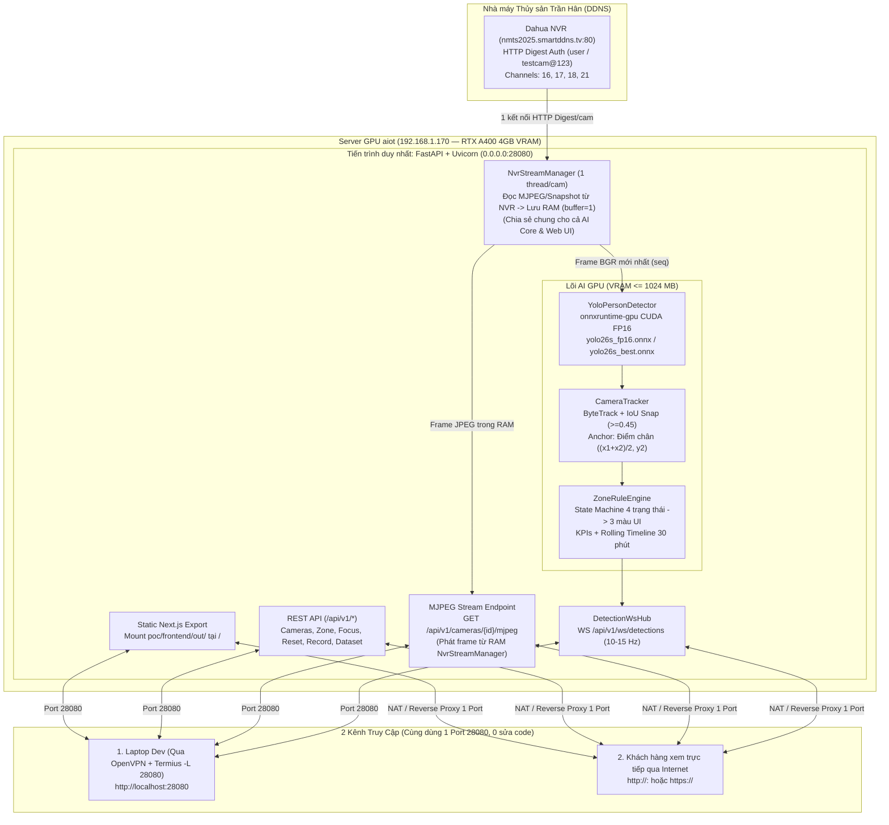

# PoC v001 — Tổng Quan Kiến Trúc & Kế Hoạch Triển Khai (FastAPI + Next.js Single-Port trên Server `aiot`)

> **Tài liệu dành cho**: Agent triển khai (**Hydrogen** / **Neon**) và Kỹ thuật viên vận hành trên server `aiot`.  
> **Thư mục tài liệu**: `poc/docs/pocv001/`  
> **Trạng thái kiến trúc**: **ĐÃ CHỐT (APPROVED)** — Triển khai chính xác theo bộ tài liệu này, không tự ý thay đổi kiến trúc.

---

## 1. Danh Mục Tài Liệu Trong `poc/docs/pocv001/`

Bộ tài liệu triển khai PoC v001 được chia thành 5 file chuyên biệt để **Hydrogen / Neon** đọc và thực thi tuần tự không sót bất kỳ chi tiết nào:

1. **[00_MASTER_OVERVIEW_AND_ARCHITECTURE.md](file:///e:/ATIN/atin_tran_han_industry/poc/docs/pocv001/00_MASTER_OVERVIEW_AND_ARCHITECTURE.md)** *(File này)*: Bối cảnh, kiến trúc chốt (Next.js Static Export + FastAPI 1-Port + Direct NVR RAM-Stream + Dual-Speed Canvas), quy tắc nghiệp vụ và yêu cầu bàn giao bắt buộc.
2. **[01_BACKEND_AND_AI_CORE_SPEC.md](file:///e:/ATIN/atin_tran_han_industry/poc/docs/pocv001/01_BACKEND_AND_AI_CORE_SPEC.md)**: Đặc tả chi tiết đến từng hàm, schema, endpoint và cấu hình của Backend FastAPI + Lõi AI GPU (`onnxruntime-gpu` FP16, ByteTrack IoU Snap, State Machine 4 trạng thái, Shared NVR MJPEG StreamReader, WebSocket Hub).
3. **[02_FRONTEND_NEXTJS_SPEC.md](file:///e:/ATIN/atin_tran_han_industry/poc/docs/pocv001/02_FRONTEND_NEXTJS_SPEC.md)**: Đặc tả chi tiết ứng dụng Next.js (App Router + TypeScript + Tailwind CSS), cấu hình `output: 'export'`, kiến trúc Dual-Speed Rendering (0 React re-render cho BBox 15 FPS), HUD 3 màu + Timeline 30 phút, Zone Editor và trang Dataset.
4. **[03_SERVER_AIOT_DEPLOYMENT_AND_HANDOFF_GUIDE.md](file:///e:/ATIN/atin_tran_han_industry/poc/docs/pocv001/03_SERVER_AIOT_DEPLOYMENT_AND_HANDOFF_GUIDE.md)**: Hướng dẫn Step-by-Step từ lúc SSH vào `tts@aiot:~/projects/tien$`, cài đặt Node.js runtime, clone repo từ GitHub, cài `.venv` GPU, build Next.js, chạy thử qua Termius Port Forwarding, cho đến khi bàn giao 1 Port cho công ty mở Public / Domain.
5. **[04_DESIGN_SYSTEM.md](file:///e:/ATIN/atin_tran_han_industry/poc/docs/pocv001/04_DESIGN_SYSTEM.md)**: Hệ thống thiết kế UI/UX hợp nhất lấy **ATIN IOC Platform (`ds-atin1.md` & `ds-atin2.md`)** làm gốc kết hợp với **Soft Clean Cards (`design-system.md`)** — quy định bộ Design Tokens, `globals.css`, `tailwind.config.ts`, 7 trạng thái component và tiêu chuẩn WCAG 2.2 AA.

---

## 2. Bối Cảnh Thực Tế & Các Quyết Định Kiến Trúc Đã Chốt

### 2.1. Mục tiêu vận hành PoC v001
1. **Chạy trọn gói Backend FastAPI + Frontend Next.js ngay trên server GPU `aiot` (`192.168.1.170`, NVIDIA RTX A400 4GB VRAM)** tại thư mục làm việc `tts@aiot:~/projects/tien$`.
2. **Gom toàn bộ hệ thống về 1 Port duy nhất** (mặc định `PORT=28080`, có thể đổi bất kỳ port nào qua `.env`):
   - **Khi công ty chưa mở port public**: Kỹ thuật viên xem và test ngay trên laptop cá nhân qua **Termius Local Port Forwarding** (`Local 28080 -> 127.0.0.1:28080`) tại `http://localhost:28080`.
   - **Khi công ty mở port public hoặc gắn Domain công ty**: Khách hàng (Nhà máy Thủy sản Trần Hân) truy cập trực tiếp qua Internet (`http://<PUBLIC_IP>:<PORT>` hoặc `https://<DOMAIN_CTY>`) **mà không cần cài OpenVPN hay Termius**.
3. **Lấy luồng trực tiếp từ NVR Trần Hân (`nmts2025.smartddns.tv:80`) — Tạm hoãn MediaMTX WebRTC 3-port**:
   - Việc dựng MediaMTX WebRTC qua 3 port (`28080`, `28889`, `28189`) sẽ để dành cho giai đoạn sau khi chốt dự án.
   - Trong PoC v001, để **tiện lợi tối đa và đi lọt 100% qua 1 port public duy nhất**, hệ thống lấy trực tiếp luồng hình ảnh từ DDNS `nmts2025.smartddns.tv` (tài khoản `user` / `testcam@123`, HTTP Digest Auth) vào RAM của Backend để vừa chạy AI trên GPU, vừa phát MJPEG đồng bộ ra Frontend qua cùng port `28080`.
4. **Build nhanh & Update liên tục**:
   - Sau này chốt dự án sẽ tách riêng FE và BE, nhưng hiện tại PoC cần update tính năng liên tục mỗi ngày.
   - Do đó chọn **Next.js Static Export (`output: 'export'`)** được FastAPI mount trực tiếp tại `/`: chỉ cần **1 lệnh chạy duy nhất**, **1 tiến trình duy nhất**, bấm `Ctrl + C` giải phóng sạch 100% port + tiến trình + VRAM.

---

### 2.2. Sơ đồ Kiến trúc Tổng thể PoC v001 (Single-Port Direct NVR Architecture)

---

### 2.3. Tại sao "Shared NVR RAM-Stream (`NvrStreamManager`)" là chìa khóa sống còn của PoC này?

Nếu để thẻ `` của trình duyệt và worker AI mở các kết nối độc lập tới `nmts2025.smartddns.tv:80`:
- Khi 3–4 người phía khách hàng cùng mở trang PoC xem 4 camera $\rightarrow$ tạo ra **16–20 kết nối MJPEG đồng thời** dội về đường truyền DDNS của nhà máy Trần Hân $\rightarrow$ **NVR quá tải, rớt khung hình hoặc từ chối kết nối (HTTP 503)**.
- Hơn nữa, luồng MJPEG trình duyệt xem và ảnh snapshot AI chấm sẽ **lệch thời gian với nhau**, làm BBox vẽ trên Canvas không khớp với bước chân nhân viên.

**Giải pháp của PoC v001 (`NvrStreamManager` trong Backend)**:
1. Với mỗi camera `enabled`, Backend chỉ mở **đúng 1 kết nối HTTP Digest duy nhất** tới NVR Trần Hân để kéo luồng MJPEG (`/cgi-bin/mjpg/video.cgi`, tự động fallback về `/cgi-bin/snapshot.cgi` tốc độ cao nếu kênh đó nghẽn MJPEG).
2. Mỗi khi tách được 1 frame JPEG mới từ NVR, `NvrStreamManager` lưu nguyên **`jpeg_bytes`** và ảnh đã giải mã **`bgr_frame`** vào slot bộ nhớ RAM (`buffer = 1`, gắn số thứ tự `seq`).
3. **AI Worker (`GpuBatcher`)** lấy `bgr_frame` từ RAM để chạy YOLO FP16 trên RTX A400 + ByteTrack + Rule Engine và đẩy kết quả qua WebSocket `/api/v1/ws/detections`.
4. **Endpoint `GET /api/v1/cameras/{cam_id}/mjpeg`** đọc trực tiếp `jpeg_bytes` từ chính slot RAM đó đẩy xuống cho **tất cả các trình duyệt đang mở**!
   - **Kết quả**: Dù có 10 khách hàng cùng vào xem PoC trên Internet, NVR Trần Hân vẫn chỉ chịu tải **1 kết nối/camera**, băng thông DDNS nhẹ tuyệt đối, và **khung hình video trên trình duyệt khớp pha 100% với BBox AI!**

---

## 3. Quy Tắc Nghiệp Vụ Cốt Lõi (Giám Sát Duy Trì Nhân Viên Trong Vùng)

Tham chiếu trực tiếp từ 3 ảnh mẫu của PM tại `poc/frontend/requirment/{CoNhanVien.jpg, VungTrong.jpg, KhongCoNhanVien.jpg}`:

### 3.1. Bảng ánh xạ 4 Trạng thái Nội bộ → 3 Màu Giao diện (UI)

| Trạng thái (`status`) | Màu UI (`ui_color`) | Mã màu Hex | Nhãn chính (`status_label`) | Nhãn phụ (`sub_label`) | Nhãn Pill trên Đỉnh Polygon | Điều kiện kích hoạt |
| :--- | :---: | :---: | :--- | :--- | :--- | :--- |
| **`present`** | 🟢 `green` | `#22c55e` | **CÓ NHÂN VIÊN** | `{N} người trong vùng` | `{TÊN VÙNG} · {N} NV` | `in_zone_count >= 1` |
| **`leaving`** | 🟢 `green` | `#22c55e` | **CÓ NHÂN VIÊN** | `Vừa rời khỏi vùng` | `{TÊN VÙNG} · VỪA RỜI VÙNG` | Vừa chuyển từ `present` sang `in_zone_count == 0`, và thời gian trống `< grace_seconds` (mặc định `2.0s`) |
| **`empty`** | 🟡 `yellow` | `#f59e0b` | **VÙNG TRỐNG** | `không có người {MM:SS}` | `{TÊN VÙNG} · TRỐNG` | Cold start (chưa từng có người) hoặc hết `grace_seconds` (`2.0s`) từ `leaving`, và thời gian ở trạng thái vàng `< warning_seconds` (mặc định `10.0s`) |
| **`alert`** | 🔴 `red` | `#ef4444` | **KHÔNG CÓ NHÂN VIÊN** | `Cảnh báo · vùng trống {MM:SS}` | `{TÊN VÙNG} · KHÔNG CÓ NHÂN VIÊN` | Ở trạng thái `empty` đủ `>= warning_seconds` (`10.0s`, tức tổng `00:12` nếu đi từ `present` → `leaving` 2s → `empty` 10s → `alert`) + **Viền khung camera sáng đỏ `3px`** |

### 3.2. Các quy tắc hiển thị bắt buộc trên Live View
1. **Điểm neo kiểm tra trong vùng (Anchor Point)**: Dùng **điểm giữa cạnh đáy BBox (điểm chân)** `(foot_x, foot_y) = ((x1 + x2) / 2, y2)`. Vẽ chấm tròn trắng có viền màu tương ứng ngay dưới chân nhân viên.
2. **Hiển thị BBox trong vùng vs ngoài vùng**:
   - **Nhân viên TRONG vùng (`in_zone === true`)**: Vẽ nét liền đậm `2px` màu xanh lá `#22c55e`, nhãn pill nền xanh chữ trắng `Nhân viên #{track_id}`, chấm chân nổi bật.
   - **Nhân viên NGOÀI vùng (`in_zone === false`)**: Vẽ làm mờ (`globalAlpha = 0.42`), viền mảnh `1.25px` màu xám `#94a3b8`, nhãn nhỏ `#{track_id}`.
3. **Chống bóng ma BBox (Anti-Ghosting)**: Nếu dữ liệu detection của camera cũ hơn `1.5 giây` (`Date.now()/1000 - detection.updated_at > 1.5`), Canvas vẫn giữ Polygon vùng giám sát nhưng tự động xóa các BBox cũ để không bị treo khung hình trên video.
4. **HUD góc trên-trái mỗi camera**:
   - Nền kính mờ tối (`rgba(18, 22, 28, 0.78)`, `backdrop-filter: blur(8px)`), thanh màu dọc `4px` bên trái đổi màu theo `green / yellow / red`.
   - Hiển thị đủ 5 thành phần:
     1. Tiêu đề phụ: `GIÁM SÁT NHÂN VIÊN · {TÊN VÙNG}`
     2. Chấm tròn trạng thái + Nhãn chính (`CÓ NHÂN VIÊN` / `VÙNG TRỐNG` / `KHÔNG CÓ NHÂN VIÊN`)
     3. Nhãn phụ (`1 người trong vùng` / `Vừa rời khỏi vùng` / `không có người 00:02` / `Cảnh báo · vùng trống 00:12`)
     4. Thống kê phiên: `Tổng thời gian cảnh báo: {MM:SS} · Số lần cảnh báo: {alert_count}`
     5. Thanh **Dòng thời gian (30p gần nhất)** (`hud-timeline-bar`) hiển thị các dải màu `green / yellow / red` nối tiếp theo tỷ lệ thời gian thực.

---

## 4. Yêu Cầu Bắt Buộc Đối Với Hydrogen / Neon Khi Thực Thi

Khi **Hydrogen** hoặc **Neon** nhận nhiệm vụ từ bộ tài liệu này, phải thực hiện nghiêm ngặt 5 cam kết sau:

1. **Đọc đủ cả 4 file trong `poc/docs/pocv001/`** trước khi viết dòng code đầu tiên.
2. **Tuân thủ cô lập môi trường 100% (`AGENTS.md`)**:
   - Python: Mọi lệnh chạy và cài đặt phải nằm trong `poc/backend/.venv` thông qua `uv`. Tuyệt đối không cài gói vào global Python hay Conda `(base)`.
   - Node.js: Mọi dependency của Next.js nằm trong `poc/frontend/node_modules`. Không dùng `npm install -g`.
3. **Không dùng `ultralytics` lúc runtime**:
   - Toàn bộ suy luận YOLO chạy thuần trên `onnxruntime` (CPU ở local Windows, `onnxruntime-gpu` với `CUDAExecutionProvider` + giới hạn VRAM `1024 MB` trên server `aiot`).
   - Sử dụng model thực tế đang có trong repo là `poc/models/yolo26s_best.onnx` (và bản convert FP16 `poc/models/yolo26s_fp16.onnx`).
4. **Kiểm thử đầy đủ trước khi báo cáo hoàn thành**:
   - Chạy `pytest -v` và `ruff check app tests` trong `poc/backend/` đạt **0 lỗi, 100% test pass**.
   - Chạy `npm run build` trong `poc/frontend/` xuất thành công thư mục tĩnh `poc/frontend/out/`.
   - Start thử FastAPI kết hợp `poc/frontend/out/` trên 1 port, kiểm tra `/api/v1/health`, `/api/v1/config`, `/api/v1/cameras`, `/api/v1/ws/detections` và giao diện Next.js tại `/`.
5. **Viết & Cập nhật Hướng dẫn Triển khai Step-by-Step lên Server `aiot`**:
   - Sau khi code và test xong, Hydrogen/Neon phải rà soát và cập nhật lại file **[03_SERVER_AIOT_DEPLOYMENT_AND_HANDOFF_GUIDE.md](file:///e:/ATIN/atin_tran_han_industry/poc/docs/pocv001/03_SERVER_AIOT_DEPLOYMENT_AND_HANDOFF_GUIDE.md)** (hoặc báo cáo bàn giao) khớp 100% với tên script, biến `.env` và câu lệnh thực tế để người dùng chỉ cần copy-paste từ bước `tts@aiot:~/projects/tien$` → `git clone` → cài Node.js → build → run là hệ thống chạy ngay lập tức.
