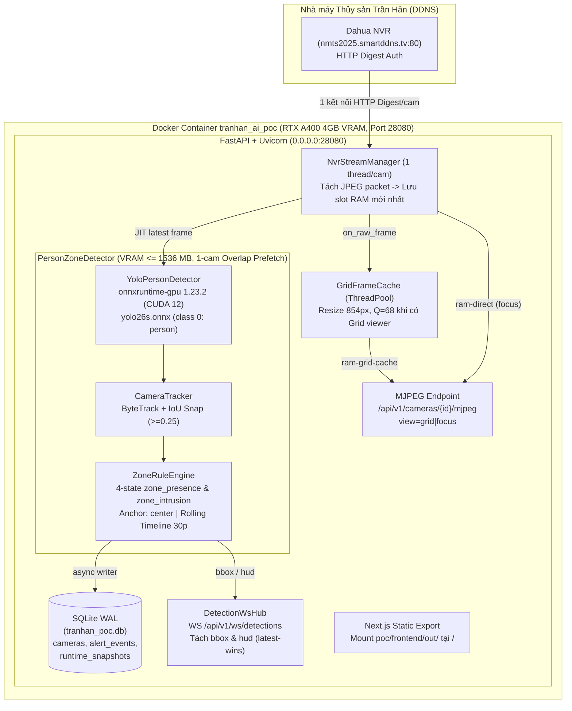

# PoC v001 — Tổng Quan Kiến Trúc & Trạng Thái Triển Khai (FastAPI + Next.js Single-Port trên Server `aiot`)

> **Thư mục tài liệu**: `poc/docs/pocv001/`  
> **Trạng thái hệ thống**: **ĐÃ TRIỂN KHAI & VẬN HÀNH THỰC TẾ** trên server GPU `aiot` (`192.168.1.170`, cổng `28080`, public domain `https://tranhan.atin.vn/`).

---

## 1. Danh Mục Tài Liệu Trong `poc/docs/pocv001/`

1. **[00_MASTER_OVERVIEW_AND_ARCHITECTURE.md](file:///e:/ATIN/atin_tran_han_industry/poc/docs/pocv001/00_MASTER_OVERVIEW_AND_ARCHITECTURE.md)** *(File này)*: Bối cảnh, kiến trúc thực tế (Next.js Static Export + FastAPI 1-Port + Shared NVR RAM-Stream + `GridFrameCache` + WebSocket Split Push), quy tắc nghiệp vụ và kiểm soát hiển thị.
2. **[01_BACKEND_AND_AI_CORE_SPEC.md](file:///e:/ATIN/atin_tran_han_industry/poc/docs/pocv001/01_BACKEND_AND_AI_CORE_SPEC.md)**: Đặc tả chi tiết Backend FastAPI + Lõi AI GPU (`onnxruntime-gpu==1.23.2` CUDA 12, `yolo26s.onnx`, ByteTrack IoU Snap, State Machine 4 trạng thái, SQLite WAL, `GridFrameCache`, `PersonZoneDetector` overlap prefetch, WebSocket Hub).
3. **[02_FRONTEND_NEXTJS_SPEC.md](file:///e:/ATIN/atin_tran_han_industry/poc/docs/pocv001/02_FRONTEND_NEXTJS_SPEC.md)**: Đặc tả ứng dụng Next.js 15 (App Router + React 19 + TypeScript + Tailwind CSS), cấu hình `output: 'export'`, Dual-Speed Rendering (`DetectionStore` + HiDPI `<canvas>`), Minimal HUD 3 màu + Timeline 30 phút, Zone Editor, Fullscreen `FocusModal` và `DatasetView`.
4. **[03_SERVER_AIOT_DEPLOYMENT_AND_HANDOFF_GUIDE.md](file:///e:/ATIN/atin_tran_han_industry/poc/docs/pocv001/03_SERVER_AIOT_DEPLOYMENT_AND_HANDOFF_GUIDE.md)**: Hướng dẫn triển khai Docker Compose BuildKit tại `poc/` (khuyến nghị chính) và quy trình chạy Native `.venv` dự phòng trên server `aiot`.
5. **[04_DESIGN_SYSTEM.md](file:///e:/ATIN/atin_tran_han_industry/poc/docs/pocv001/04_DESIGN_SYSTEM.md)**: Hệ thống thiết kế UI/UX hợp nhất **ATIN IOC Platform** × **Soft Clean Cards**.
6. **[issuse.md](file:///e:/ATIN/atin_tran_han_industry/poc/docs/pocv001/issuse.md)**: Nhật ký sự cố thực tế (`ISS-01` → `ISS-13`), nguyên nhân gốc và cách xử lý đã áp dụng.

---

## 2. Bối Cảnh Thực Tế & Kiến Trúc Đã Triển Khai

### 2.1. Mục tiêu vận hành PoC v001
1. **Đóng gói trọn gói Backend FastAPI + Frontend Next.js trong 1 container Docker** (`poc/Dockerfile`, `poc/docker-compose.yml`) chạy trên server GPU `aiot` (`192.168.1.170`, NVIDIA RTX A400 4GB VRAM).
2. **1 Port duy nhất (`28080`)**:
   - Truy cập nội bộ / Termius Port Forwarding (`http://localhost:28080`) hoặc qua HTTPS public của công ty (`https://tranhan.atin.vn/`).
3. **Lấy luồng trực tiếp từ NVR Trần Hân (`nmts2025.smartddns.tv:80`)**:
   - Backend mở **1 kết nối HTTP Digest / camera** vào `NvrStreamManager` trong RAM, vừa cấp frame cho GPU AI vừa phân phối lại luồng MJPEG cho mọi trình duyệt (`ram-grid-cache` cho Grid View, `ram-direct` cho Focus View).

---

### 2.2. Sơ đồ Kiến trúc Tổng thể PoC v001

---

## 3. Quy Tắc Nghiệp Vụ & Hiển Thị Thực Tế

### 3.1. Bảng ánh xạ 4 Trạng thái Nội bộ → 3 Màu Giao diện (`zone_presence`)

| Trạng thái (`status`) | Màu UI (`ui_color`) | Mã màu Hex | Nhãn chính (`status_label`) | Nhãn phụ (`sub_label`) | Nhãn Pill trên Đỉnh Polygon | Điều kiện kích hoạt |
| :--- | :---: | :---: | :--- | :--- | :--- | :--- |
| **`present`** | 🟢 `green` | `#22c55e` | **CÓ NHÂN VIÊN** | `{N} người trong vùng` | `{TÊN VÙNG} · {N} NV` | `in_zone_count >= 1` |
| **`leaving`** | 🟢 `green` | `#22c55e` | **CÓ NHÂN VIÊN** | `Vừa rời khỏi vùng` | `{TÊN VÙNG} · VỪA RỜI VÙNG` | Vừa chuyển từ `present` sang `in_zone_count == 0`, `< grace_seconds` (`2.0s`) |
| **`empty`** | 🟡 `yellow` | `#f59e0b` | **VÙNG TRỐNG** | `không có người {MM:SS}` | `{TÊN VÙNG} · TRỐNG` | Cold start hoặc hết `grace_seconds`, `< warning_seconds` (`10.0s`) |
| **`alert`** | 🔴 `red` | `#ef4444` | **KHÔNG CÓ NHÂN VIÊN** | `Cảnh báo · vùng trống {MM:SS}` | `{TÊN VÙNG} · KHÔNG CÓ NHÂN VIÊN` | Ở `empty` đủ `>= warning_seconds` + Viền khung camera sáng đỏ `3px` |
| **`idle`** | 🔵 `idle` | `#0284c7` | **CHƯA VẼ VÙNG** | `Vẽ vùng giám sát để kích hoạt` | *(không có)* | Camera chưa vẽ đa giác (`len(zone) < 3`) |

### 3.2. Quy tắc hiển thị thực tế trên Live View
1. **Điểm neo & Ngưỡng AI (`config.py`)**:
   - Mặc định dùng `AI_ANCHOR_MODE=center` (tâm BBox `(cx, cy)`) và `AI_CONF_THRESHOLD=0.55`.
   - Không vẽ chấm tròn anchor trên canvas để giữ khung hình sạch.
2. **Hiển thị BBox trong vùng vs ngoài vùng (`CameraOverlayCanvas.tsx`)**:
   - **Nhân viên TRONG vùng (`in_zone === true`)**: Vẽ nét liền `2px` màu xanh lá `#22C55E`, nhãn `%` độ tin cậy nền `#16A34A` chữ trắng (VD: `87%`).
   - **Nhân viên NGOÀI vùng (`in_zone === false`)**: Vẽ làm mờ (`globalAlpha = 0.42`), viền mảnh `1.25px` màu xám `#94A3B8`, nhãn `%` nền `#334155`.
3. **Chống bóng ma BBox & Lệch đồng hồ (Clock Skew)**:
   - Frontend đóng dấu `_client_ts = Date.now() / 1000` khi nhận WS message và tự xóa BBox cũ nếu quá `bbox_stale_seconds` (`1.8s` từ `/api/v1/config`), giữ nguyên đa giác vùng giám sát.
4. **HUD & Minimal Card View (`CameraCard.tsx`, `ZoneHudOverlay.tsx`)**:
   - Nền kính mờ trong suốt (`rgba(15, 23, 42, 0.44)`), thanh màu dọc `3px` bên trái, hiển thị trạng thái, bộ đếm cảnh báo (`Cảnh báo: N · MM:SS`) và thanh **Timeline (30p)**.
   - Trong chế độ Live View bình thường, badge `"Trực tiếp"` góc trên-phải được ẩn đi; chỉ hiện badge khi tạm dừng hoặc `connecting`/`error`.
   - Khi nhấn phóng to (`FocusModal`), mở chế độ toàn màn hình (`requestFullscreen()` với fallback fixed viewport) sử dụng luồng `subtype=0&view=focus`.

---

## 4. Quy Chuẩn Môi Trường & Đóng Gói

- **Local Dev**:
  - Backend: `poc/backend/.venv` (quản lý bằng `uv` / `pyproject.toml`), chạy `ruff` + `pytest`.
  - Frontend: `poc/frontend/node_modules`, kiểm tra bằng `tsc --noEmit` và `npm run build`.
- **Production PoC (Docker tại `poc/`)**:
  - `poc/Dockerfile` (BuildKit `1.7`): Stage 1 `node:20-alpine` export `out/`; Stage 2 `nvidia/cuda:12.4.1-cudnn-runtime-ubuntu22.04` cài đặt từ `poc/backend/requirements/docker.txt` (`onnxruntime-gpu==1.23.2`, `opencv-python-headless==5.1.0.95`, `supervision==0.27.0.post2`).
  - Model thực tế: `poc/models/yolo26s.onnx` (`{0: 'person'}`).
